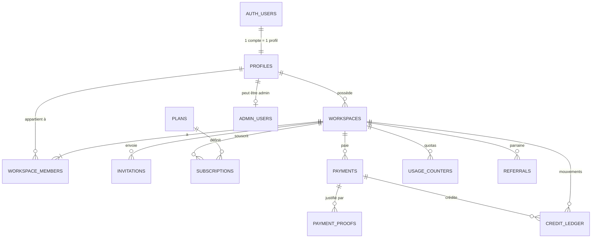
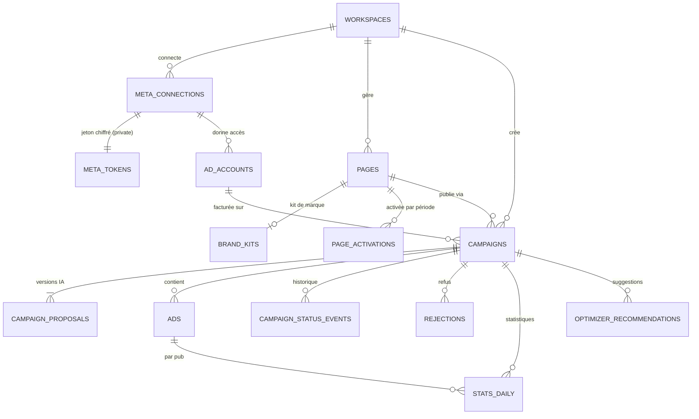
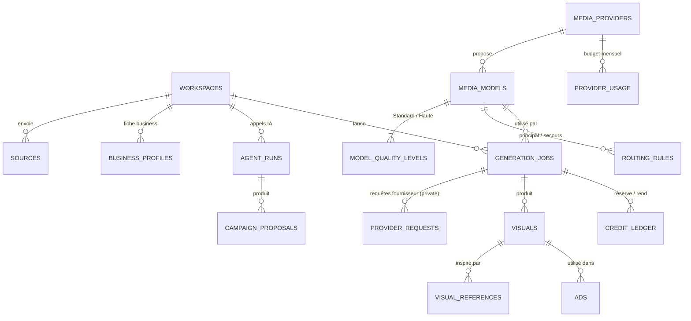
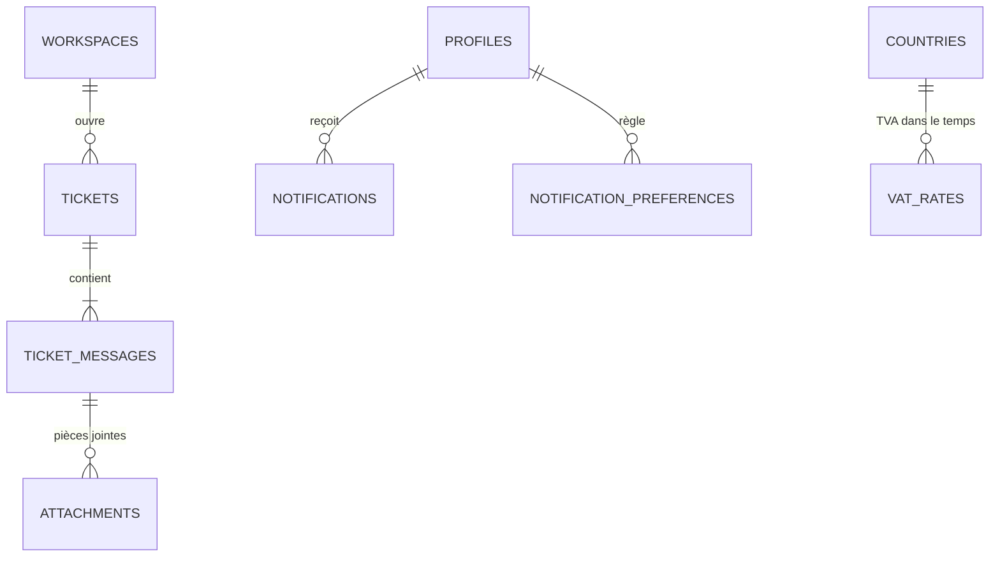

# DATA_MODEL — Modèle de données Pubeka

> Version 1 · 10 octobre 2026 · **Document de référence des données.** Remplace l'ancien `MODELE-DE-DONNEES.md`.
> Source de vérité : les migrations SQL [`supabase/migrations/`](../../supabase/migrations/). La section 6 (schémas des tables) est **générée automatiquement** à partir de la base réelle par [`supabase/scripts/gen-data-model.mjs`](../../supabase/scripts/gen-data-model.mjs) : elle ne peut pas diverger du SQL.
> Sécurité des données : [SECURITE-BACKEND.md](SECURITE-BACKEND.md) · tests : [`supabase/tests/security.test.mjs`](../../supabase/tests/security.test.mjs) (44/44), [`api-support.test.mjs`](../../supabase/tests/api-support.test.mjs) (migration 0003) et [`login-attempts.test.mjs`](../../supabase/tests/login-attempts.test.mjs) (migration 0004) et [`uploads.test.mjs`](../../supabase/tests/uploads.test.mjs) (migrations 0008 et 0009) et [`campaign-drafts.test.mjs`](../../supabase/tests/campaign-drafts.test.mjs) (migration 0010) et [`africa-countries.test.mjs`](../../supabase/tests/africa-countries.test.mjs) (migration 0012 : les 54 pays d'Afrique, leurs monnaies, les taux de change de toute monnaie) et [`exchange-rates.test.mjs`](../../supabase/tests/exchange-rates.test.mjs) (migration 0013 : fraîcheur et accès aux taux).

---

## 1. Conventions

| Sujet | Règle |
|---|---|
| Base | PostgreSQL (Supabase), région Irlande |
| Schémas | `public` (exposé par l'API, protégé par RLS) · `private` (secrets et internes, **jamais exposé**) · `audit` (journal, jamais exposé) · `auth` (Supabase Auth) · `storage` (fichiers) |
| Clés | `uuid` (`gen_random_uuid()`) ; `bigint identity` pour les journaux et registres en ajout seul |
| Dates | `timestamptz` en UTC ; affichage converti dans le fuseau de l'utilisateur |
| Argent | XAF en `bigint` (entiers) ; coûts fournisseurs en `numeric(12,6)` USD ; budgets Meta en **centimes de dollar** (`int`) |
| Données souples | `jsonb` pour les sorties des agents (fiche business, proposition, `VisualSpec`) et réglages fournisseurs |
| Multi-clients | **Toute table métier porte `workspace_id`** ; la RLS s'appuie dessus |
| Noms | tables au pluriel, colonnes en `snake_case`, anglais pour le code |
| Suppression | `on delete cascade` depuis l'espace (suppression de compte) ; `restrict` sur les paiements (obligation légale) ; `set null` pour les liens facultatifs |
| Ajout seul | `credit_ledger`, `audit.admin_log` : modification, suppression et vidage bloqués par déclencheur |

---

## 2. Diagramme entité-relation

### 2.1 Comptes, facturation, crédits


### 2.2 Meta, Pages, campagnes


### 2.3 Sources, agents, médias


### 2.4 Support, notifications, référentiels


Légende : `||--||` exactement un · `||--o|` zéro ou un · `||--|{` un ou plusieurs · `||--o{` zéro ou plusieurs.

---

## 3. Relations et cardinalités

| Relation | Cardinalité | Règle métier | Clé / contrainte |
|---|---|---|---|
| Utilisateur Supabase → profil | 1 – 1 | Créé à l'inscription | `profiles.id` = `auth.users.id`, cascade |
| Profil → espaces possédés | 1 – N | Un propriétaire par espace | `workspaces.owner_id` |
| Espace ↔ profils (équipe) | N – N | 1 / 2 / 5 membres selon la formule (contrôlé par le serveur) | `workspace_members` (PK composée), rôle `owner` · `editor` · `viewer` |
| Espace → abonnements | 1 – N | Un seul abonnement non annulé à la fois ; historique conservé | `subscriptions.workspace_id` |
| Formule → abonnements | 1 – N | Starter, Pro, Business | `subscriptions.plan_code` |
| Espace → paiements | 1 – N | `idempotency_key` unique ; `provider_payment_id` unique | `payments`, `on delete restrict` |
| Paiement → preuves | 1 – N | Envoyées par le propriétaire, traitées par l'admin | `payment_proofs.payment_id` (facultatif) |
| Espace → registre des crédits | 1 – N | Solde = somme ; ajout seul | `credit_ledger` |
| Génération → mouvements de crédits | 1 – N | Réserve → consommation **ou** libération, jamais les deux | `credit_ledger.generation_job_id` |
| Connexion Meta → jeton | 1 – 1 | Jeton chiffré, schéma `private` | `private.meta_tokens.connection_id` |
| Connexion Meta → comptes publicitaires | 1 – N | Compte changeable librement | `ad_accounts`, unique (espace, id Meta) |
| Espace → Pages | 1 – N | 1 / 3 / 10 Pages actives selon la formule | `pages`, unique (espace, id Meta) |
| Page → kit de marque | 1 – 0..1 | Logo, couleurs, ton des pubs | `brand_kits.page_id` (PK) |
| Page → activations | 1 – N | Formule 1 Page : Page figée pour la période dès la 1re campagne | `page_activations` (espace, Page, période) |
| Espace → campagnes | 1 – N | Quota décompté au clic sur Publier | `campaigns.workspace_id` |
| Campagne → propositions | 1 – N | Toutes les versions IA gardées (« similaire à ») | unique (campagne, version) |
| Campagne → pubs | 1 – N | 2 pubs en test A/B (variantes A et B) | `ads.campaign_id` |
| Visuel → pubs | 1 – N | Un visuel utilisé en campagne est conservé | `ads.visual_id` |
| Campagne → statistiques | 1 – N | Une ligne par jour (et par pub) | unique (campagne, pub, date) |
| Campagne → refus | 1 – N | Rapport du Modérateur, republication sans quota | `rejections.campaign_id` |
| Fournisseur → modèles | 1 – N | fal, Higgsfield, BytePlus | `media_models.provider_code` |
| Modèle → niveaux de qualité | 1 – 1..2 | Standard, Haute qualité ; crédits calculés | PK (modèle, niveau) |
| Capacité → modèles (routage) | 1 principal, 0..1 secours | Bascule proposée après 60 s | `routing_rules` |
| Génération → requêtes fournisseur | 1 – N | Un identifiant de requête = une seule génération | `private.provider_requests` PK (fournisseur, id) |
| Génération → visuels | 1 – N | 3 visuels par défaut | `visuals.generation_job_id` |
| Visuel → références | 1 – N | Photo, visuel choisi, bibliothèque | `visual_references` |
| Ticket → messages → pièces jointes | 1 – N – N | Réponse admin envoyée aussi par e-mail | cascade |
| Espace → filleuls | 1 – N | Un espace n'est parrainé qu'une fois, jamais par lui-même | `referrals.referred_workspace_id` unique, contrôle ≠ |
| Pays → taux de TVA | 1 – N | Historique par date de validité | PK (pays, date) |

---

## 4. Cycle de vie des données

| Donnée | Conservation |
|---|---|
| Compte, campagnes, statistiques, propositions, `VisualSpec` | Tant que le compte existe |
| Fichiers des visuels non utilisés | 7 jours (`visuals.files_expire_at`), puis suppression du fichier ; la ligne reste |
| Fichiers des visuels utilisés en campagne | Tant que la campagne existe |
| Sources envoyées (photos, PDF) | 7 jours (`sources.expires_at`) |
| Paiements et preuves | Conservés après suppression du compte (obligation légale) |
| Registre des crédits, journal d'administration | Permanents (ajout seul) |
| Suppression de compte | Cascade depuis `workspaces` et `profiles` ; paiements conservés (`restrict`) |

---

## 5. Migrations et versions

### 5.1 Principe
- **Une migration = un fichier SQL numéroté** dans `supabase/migrations/` : `0001_init.sql`, `0002_storage.sql`, `0003_api_support.sql`, `0004_login_attempts.sql`. Ordre d'application = ordre des numéros.
- **Une migration appliquée n'est jamais modifiée.** Toute correction = **nouvelle migration**.
- Chaque migration est **transactionnelle** (`begin` … `commit`) : tout ou rien.
- Application avec l'outil de migration Supabase, sur **développement d'abord**, puis production.

### 5.2 Règles pour migrer sans interruption
| Changement | Méthode |
|---|---|
| Ajouter une colonne | Nullable ou avec défaut ; jamais `not null` sans défaut sur une table remplie |
| Renommer / supprimer une colonne | En 3 temps : ajouter la nouvelle → le code écrit dans les deux → migrer les données → retirer l'ancienne dans une migration suivante |
| Ajouter une valeur d'énumération | `alter type … add value` dans sa propre migration |
| Index sur une grosse table | `create index concurrently` (hors transaction) |
| Nouvelle table | Toujours : `workspace_id` si métier, **RLS activée**, droits colonne par colonne, politiques, **test d'accès croisé ajouté** |

### 5.3 Contrôles obligatoires avant production
1. Les migrations s'appliquent sur une base vide (PGlite en CI, puis projet Supabase de développement).
2. `db/tests/security.test.mjs` passe à 100 %.
3. Le contrôle « RLS activée sur 100 % des tables » passe (inclus dans les tests).
4. Le conseiller de sécurité Supabase ne signale aucune alerte.
5. La section 6 de ce document est **régénérée** et commitée avec la migration.
6. Les types TypeScript sont régénérés (`supabase gen types typescript`).

### 5.4 Versions des données JSON
- Les colonnes `jsonb` issues des agents portent leur version : `business_profiles.version`, `agent_runs.prompt_version`.
- Un changement incompatible du schéma JSON d'un agent = nouvelle version ; le code sait lire les anciennes.

### 5.5 Retour arrière
- Pas de migration « descendante » automatique : on corrige **en avant** avec une nouvelle migration.
- Avant une migration risquée en production : sauvegarde à la demande (Supabase Pro) et répétition sur une copie de développement.

### 5.6 Données de référence
Formules, fournisseurs et réglages initiaux sont insérés par la migration `0001` (section 18). Leurs modifications ultérieures se font **depuis l'administration** (journalisées), pas par migration, sauf changement de structure.

### 5.7 Régénérer la section 6
```bash
pnpm --filter @pubeka/db db:data-model > /tmp/schema.md
```
Puis remplacer la section 6 par le contenu de `/tmp/schema.md`.

---

## 6. Schémas des tables (générés depuis la base)
<!-- GÉNÉRÉ PAR supabase/scripts/gen-data-model.mjs — ne pas modifier à la main -->
### Énumérations

| Énumération | Valeurs |
|---|---|
| campaign_status | draft · publishing · in_review · active · paused · rejected · ended · stopped · error |
| credit_bucket | monthly · bonus · purchased |
| credit_kind | grant_monthly · purchase · reserve · consume · release · expire · admin_grant · admin_revoke · referral · trial |
| job_status | queued · running · completed · partial · failed · nsfw · canceled |
| member_role | owner · editor · viewer |
| model_status | testing · active · disabled |
| payment_purpose | subscription · upgrade · credits |
| payment_status | pending · succeeded · failed · expired · manual |
| platform | meta · google · tiktok |
| quality_level | standard · high |
| source_type | website · app_link · image · social_post · document · text |
| subscription_status | trialing · active · grace · read_only · canceled |
| ticket_status | open · waiting_user · closed |
| workspace_status | active · read_only · suspended |

### Tables (60)

#### `audit.admin_log`

| Colonne | Type | Null | Défaut |
|---|---|---|---|
| id | bigint | non | identity |
| admin_id | uuid | non |  |
| action | text | non |  |
| target_type | text | oui |  |
| target_id | text | oui |  |
| before | jsonb | oui |  |
| after | jsonb | oui |  |
| ip | inet | oui |  |
| created_at | timestamp with time zone | non | now() |

| Contrainte | Définition |
|---|---|
| n | `NOT NULL action` |
| n | `NOT NULL admin_id` |
| n | `NOT NULL created_at` |
| n | `NOT NULL id` |
| Clé primaire | `PRIMARY KEY (id)` |

RLS : activée · 0 politique(s) · schéma non exposé par l’API

#### `audit.workspace_log`

| Colonne | Type | Null | Défaut |
|---|---|---|---|
| id | bigint | non | identity |
| workspace_id | uuid | non |  |
| actor_id | uuid | non |  |
| action | text | non |  |
| before | jsonb | oui |  |
| after | jsonb | oui |  |
| created_at | timestamp with time zone | non | now() |

| Contrainte | Définition |
|---|---|
| Contrôle | `CHECK ((char_length(action) <= 60))` |
| n | `NOT NULL action` |
| n | `NOT NULL actor_id` |
| n | `NOT NULL created_at` |
| n | `NOT NULL id` |
| n | `NOT NULL workspace_id` |
| Clé primaire | `PRIMARY KEY (id)` |

RLS : activée · 0 politique(s) · schéma non exposé par l’API

#### `private.admin_users`

| Colonne | Type | Null | Défaut |
|---|---|---|---|
| profile_id | uuid | non |  |
| failed_attempts | integer | non | 0 |
| locked_until | timestamp with time zone | oui |  |
| last_login_at | timestamp with time zone | oui |  |
| created_at | timestamp with time zone | non | now() |

| Contrainte | Définition |
|---|---|
| Clé étrangère | `FOREIGN KEY (profile_id) REFERENCES profiles(id) ON DELETE CASCADE` |
| n | `NOT NULL created_at` |
| n | `NOT NULL failed_attempts` |
| n | `NOT NULL profile_id` |
| Clé primaire | `PRIMARY KEY (profile_id)` |

RLS : activée · 0 politique(s) · schéma non exposé par l’API

#### `private.app_settings`

| Colonne | Type | Null | Défaut |
|---|---|---|---|
| key | text | non |  |
| value | jsonb | non |  |
| updated_at | timestamp with time zone | non | now() |

| Contrainte | Définition |
|---|---|
| n | `NOT NULL key` |
| n | `NOT NULL updated_at` |
| n | `NOT NULL value` |
| Clé primaire | `PRIMARY KEY (key)` |

RLS : activée · 0 politique(s) · schéma non exposé par l’API

#### `private.login_failures`

| Colonne | Type | Null | Défaut |
|---|---|---|---|
| id | bigint | non | identity |
| key_hash | text | non |  |
| failed_at | timestamp with time zone | non | now() |

| Contrainte | Définition |
|---|---|
| Contrôle | `CHECK ((key_hash ~ '^[0-9a-f]{64}$'::text))` |
| n | `NOT NULL failed_at` |
| n | `NOT NULL id` |
| n | `NOT NULL key_hash` |
| Clé primaire | `PRIMARY KEY (id)` |

| Index | Définition |
|---|---|
| login_failures_key_hash_failed_at_idx | `private.login_failures USING btree (key_hash, failed_at)` |

RLS : activée · 0 politique(s) · schéma non exposé par l’API

#### `private.meta_tokens`

| Colonne | Type | Null | Défaut |
|---|---|---|---|
| connection_id | uuid | non |  |
| updated_at | timestamp with time zone | non | now() |
| sealed | text | non |  |
| key_id | text | non |  |

| Contrainte | Définition |
|---|---|
| Contrôle | `CHECK ((key_id ~ '^[A-Za-z0-9_-]{1,64}$'::text))` |
| Contrôle | `CHECK (((sealed ~ '^v1\.[A-Za-z0-9_-]{1,64}\.[A-Za-z0-9_-]+\.[A-Za-z0-9_-]+\.[A-Za-z0-9_-]+$'::text) AND (char_length(sealed) <= 4000)))` |
| Clé étrangère | `FOREIGN KEY (connection_id) REFERENCES meta_connections(id) ON DELETE CASCADE` |
| n | `NOT NULL connection_id` |
| n | `NOT NULL key_id` |
| n | `NOT NULL sealed` |
| n | `NOT NULL updated_at` |
| Clé primaire | `PRIMARY KEY (connection_id)` |

RLS : activée · 0 politique(s) · schéma non exposé par l’API

#### `private.provider_balances`

| Colonne | Type | Null | Défaut |
|---|---|---|---|
| provider_code | text | non |  |
| balance_usd | numeric | oui |  |
| checked_at | timestamp with time zone | oui |  |

| Contrainte | Définition |
|---|---|
| Clé étrangère | `FOREIGN KEY (provider_code) REFERENCES media_providers(code)` |
| n | `NOT NULL provider_code` |
| Clé primaire | `PRIMARY KEY (provider_code)` |

RLS : activée · 0 politique(s) · schéma non exposé par l’API

#### `private.provider_requests`

| Colonne | Type | Null | Défaut |
|---|---|---|---|
| provider_code | text | non |  |
| request_id | text | non |  |
| generation_job_id | uuid | non |  |
| created_at | timestamp with time zone | non | now() |

| Contrainte | Définition |
|---|---|
| Clé étrangère | `FOREIGN KEY (generation_job_id) REFERENCES generation_jobs(id) ON DELETE CASCADE` |
| Clé étrangère | `FOREIGN KEY (provider_code) REFERENCES media_providers(code)` |
| n | `NOT NULL created_at` |
| n | `NOT NULL generation_job_id` |
| n | `NOT NULL provider_code` |
| n | `NOT NULL request_id` |
| Clé primaire | `PRIMARY KEY (provider_code, request_id)` |

RLS : activée · 0 politique(s) · schéma non exposé par l’API

#### `private.rate_limits`

| Colonne | Type | Null | Défaut |
|---|---|---|---|
| bucket_key | text | non |  |
| window_start | timestamp with time zone | non |  |
| hits | integer | non | 0 |

| Contrainte | Définition |
|---|---|
| Contrôle | `CHECK (((char_length(bucket_key) >= 1) AND (char_length(bucket_key) <= 200)))` |
| n | `NOT NULL bucket_key` |
| n | `NOT NULL hits` |
| n | `NOT NULL window_start` |
| Clé primaire | `PRIMARY KEY (bucket_key, window_start)` |

RLS : activée · 0 politique(s) · schéma non exposé par l’API

#### `private.rejection_memory`

| Colonne | Type | Null | Défaut |
|---|---|---|---|
| pattern | text | non |  |
| rule_id | text | oui |  |
| count | integer | non | 1 |
| last_seen | timestamp with time zone | non | now() |

| Contrainte | Définition |
|---|---|
| n | `NOT NULL count` |
| n | `NOT NULL last_seen` |
| n | `NOT NULL pattern` |
| Clé primaire | `PRIMARY KEY (pattern)` |

RLS : activée · 0 politique(s) · schéma non exposé par l’API

#### `private.webhook_events`

| Colonne | Type | Null | Défaut |
|---|---|---|---|
| provider | text | non |  |
| event_id | text | non |  |
| received_at | timestamp with time zone | non | now() |

| Contrainte | Définition |
|---|---|
| Contrôle | `CHECK (((char_length(event_id) >= 1) AND (char_length(event_id) <= 200)))` |
| Contrôle | `CHECK (((char_length(provider) >= 1) AND (char_length(provider) <= 40)))` |
| n | `NOT NULL event_id` |
| n | `NOT NULL provider` |
| n | `NOT NULL received_at` |
| Clé primaire | `PRIMARY KEY (provider, event_id)` |

RLS : activée · 0 politique(s) · schéma non exposé par l’API

#### `public.ad_accounts`

| Colonne | Type | Null | Défaut |
|---|---|---|---|
| id | uuid | non | gen_random_uuid() |
| workspace_id | uuid | non |  |
| meta_connection_id | uuid | non |  |
| meta_ad_account_id | text | non |  |
| name | text | oui |  |
| currency | character(3) | oui |  |
| has_payment_method | boolean | oui |  |
| is_active | boolean | non | false |
| vat_country | character(2) | oui |  |

| Contrainte | Définition |
|---|---|
| Contrôle | `CHECK ((meta_ad_account_id ~ '^act_[0-9]{5,25}$'::text))` |
| Contrôle | `CHECK ((char_length(name) <= 200))` |
| Clé étrangère | `FOREIGN KEY (meta_connection_id) REFERENCES meta_connections(id) ON DELETE CASCADE` |
| Clé étrangère | `FOREIGN KEY (workspace_id) REFERENCES workspaces(id) ON DELETE CASCADE` |
| n | `NOT NULL id` |
| n | `NOT NULL is_active` |
| n | `NOT NULL meta_ad_account_id` |
| n | `NOT NULL meta_connection_id` |
| n | `NOT NULL workspace_id` |
| Clé primaire | `PRIMARY KEY (id)` |
| Unique | `UNIQUE (workspace_id, meta_ad_account_id)` |

| Index | Définition |
|---|---|
| ad_accounts_one_active | `UNIQUE public.ad_accounts USING btree (workspace_id) WHERE is_active` |

RLS : activée · 1 politique(s)

#### `public.ads`

| Colonne | Type | Null | Défaut |
|---|---|---|---|
| id | uuid | non | gen_random_uuid() |
| workspace_id | uuid | non |  |
| campaign_id | uuid | non |  |
| visual_id | uuid | oui |  |
| format | text | oui |  |
| meta_ad_id | text | oui |  |
| meta_creative_id | text | oui |  |
| status | text | oui |  |
| variant | text | oui |  |

| Contrainte | Définition |
|---|---|
| Contrôle | `CHECK ((format = ANY (ARRAY['4:5'::text, '9:16'::text, '1:1'::text, '1.91:1'::text])))` |
| Contrôle | `CHECK ((meta_ad_id ~ '^[0-9]{5,25}$'::text))` |
| Contrôle | `CHECK ((meta_creative_id ~ '^[0-9]{5,25}$'::text))` |
| Contrôle | `CHECK ((variant = ANY (ARRAY['A'::text, 'B'::text])))` |
| Clé étrangère | `FOREIGN KEY (campaign_id) REFERENCES campaigns(id) ON DELETE CASCADE` |
| Clé étrangère | `FOREIGN KEY (visual_id) REFERENCES visuals(id) ON DELETE SET NULL` |
| Clé étrangère | `FOREIGN KEY (workspace_id) REFERENCES workspaces(id) ON DELETE CASCADE` |
| n | `NOT NULL campaign_id` |
| n | `NOT NULL id` |
| n | `NOT NULL workspace_id` |
| Clé primaire | `PRIMARY KEY (id)` |

| Index | Définition |
|---|---|
| ads_campaign_meta_ad_uniq | `UNIQUE public.ads USING btree (campaign_id, meta_ad_id) WHERE (meta_ad_id IS NOT NULL)` |

RLS : activée · 1 politique(s)

#### `public.agent_runs`

| Colonne | Type | Null | Défaut |
|---|---|---|---|
| id | uuid | non | gen_random_uuid() |
| workspace_id | uuid | oui |  |
| agent | text | non |  |
| model | text | non |  |
| prompt_version | text | non |  |
| input | jsonb | oui |  |
| output | jsonb | oui |  |
| valid_schema | boolean | non |  |
| retried | boolean | non | false |
| tokens_in | integer | oui |  |
| tokens_out | integer | oui |  |
| cost_usd | numeric | oui |  |
| latency_ms | integer | oui |  |
| created_at | timestamp with time zone | non | now() |
| error_code | text | oui |  |
| provider | text | oui |  |
| requested_model | text | oui |  |
| attempts | integer | oui |  |

| Contrainte | Définition |
|---|---|
| Contrôle | `CHECK ((agent = ANY (ARRAY['analyste'::text, 'stratege'::text, 'designer'::text, 'moderateur'::text, 'optimiseur'::text, 'aide'::text])))` |
| Contrôle | `CHECK (((attempts >= 0) AND (attempts <= 2)))` |
| Contrôle | `CHECK ((char_length(error_code) <= 60))` |
| Contrôle | `CHECK ((char_length(model) <= 120))` |
| Contrôle | `CHECK ((char_length(prompt_version) <= 40))` |
| Contrôle | `CHECK ((provider = ANY (ARRAY['openrouter'::text, 'anthropic'::text, 'openai'::text, 'gemini'::text])))` |
| Contrôle | `CHECK ((char_length(requested_model) <= 120))` |
| Clé étrangère | `FOREIGN KEY (workspace_id) REFERENCES workspaces(id) ON DELETE SET NULL` |
| n | `NOT NULL agent` |
| n | `NOT NULL created_at` |
| n | `NOT NULL id` |
| n | `NOT NULL model` |
| n | `NOT NULL prompt_version` |
| n | `NOT NULL retried` |
| n | `NOT NULL valid_schema` |
| Clé primaire | `PRIMARY KEY (id)` |

RLS : activée · 1 politique(s)

#### `public.analyses`

| Colonne | Type | Null | Défaut |
|---|---|---|---|
| id | uuid | non | gen_random_uuid() |
| workspace_id | uuid | non |  |
| page_id | uuid | oui |  |
| created_by | uuid | oui |  |
| status | text | non | 'queued'::text |
| user_intent | text | oui |  |
| source_ids | uuid[] | non | '{}'::uuid[] |
| unreadable_sources | int4[] | non | '{}'::integer[] |
| business_profile_id | uuid | oui |  |
| blocked_reason | text | oui |  |
| error_code | text | oui |  |
| created_at | timestamp with time zone | non | now() |
| updated_at | timestamp with time zone | non | now() |
| flags | text[] | non | '{}'::text[] |

| Contrainte | Définition |
|---|---|
| Contrôle | `CHECK ((blocked_reason = 'illegal_product'::text))` |
| Contrôle | `CHECK (((status <> 'blocked'::text) OR (blocked_reason IS NOT NULL)))` |
| Contrôle | `CHECK (((status <> 'ready'::text) OR (business_profile_id IS NOT NULL)))` |
| Contrôle | `CHECK ((char_length(error_code) <= 60))` |
| Contrôle | `CHECK ((cardinality(flags) <= 40))` |
| Contrôle | `CHECK ((cardinality(source_ids) <= 12))` |
| Contrôle | `CHECK ((status = ANY (ARRAY['queued'::text, 'reading'::text, 'analysing'::text, 'questions'::text, 'ready'::text, 'blocked'::text, 'failed'::text])))` |
| Contrôle | `CHECK ((char_length(user_intent) <= 1000))` |
| Clé étrangère | `FOREIGN KEY (business_profile_id) REFERENCES business_profiles(id) ON DELETE SET NULL` |
| Clé étrangère | `FOREIGN KEY (created_by) REFERENCES profiles(id) ON DELETE SET NULL` |
| Clé étrangère | `FOREIGN KEY (page_id) REFERENCES pages(id) ON DELETE SET NULL` |
| Clé étrangère | `FOREIGN KEY (workspace_id) REFERENCES workspaces(id) ON DELETE CASCADE` |
| n | `NOT NULL created_at` |
| n | `NOT NULL flags` |
| n | `NOT NULL id` |
| n | `NOT NULL source_ids` |
| n | `NOT NULL status` |
| n | `NOT NULL unreadable_sources` |
| n | `NOT NULL updated_at` |
| n | `NOT NULL workspace_id` |
| Clé primaire | `PRIMARY KEY (id)` |

| Index | Définition |
|---|---|
| analyses_workspace_id_created_at_idx | `public.analyses USING btree (workspace_id, created_at DESC)` |

RLS : activée · 1 politique(s)

#### `public.api_idempotency_keys`

| Colonne | Type | Null | Défaut |
|---|---|---|---|
| workspace_id | uuid | non |  |
| key | uuid | non |  |
| route | text | non |  |
| body_hash | text | non |  |
| state | text | non | 'running'::text |
| response_status | integer | oui |  |
| response_body | jsonb | oui |  |
| created_at | timestamp with time zone | non | now() |
| expires_at | timestamp with time zone | non | (now() + '24:00:00'::interval) |

| Contrainte | Définition |
|---|---|
| Contrôle | `CHECK ((body_hash ~ '^[0-9a-f]{64}$'::text))` |
| Contrôle | `CHECK (((state <> 'done'::text) OR (response_status IS NOT NULL)))` |
| Contrôle | `CHECK (((response_status >= 100) AND (response_status <= 599)))` |
| Contrôle | `CHECK ((char_length(route) <= 200))` |
| Contrôle | `CHECK ((state = ANY (ARRAY['running'::text, 'done'::text])))` |
| Clé étrangère | `FOREIGN KEY (workspace_id) REFERENCES workspaces(id) ON DELETE CASCADE` |
| n | `NOT NULL body_hash` |
| n | `NOT NULL created_at` |
| n | `NOT NULL expires_at` |
| n | `NOT NULL key` |
| n | `NOT NULL route` |
| n | `NOT NULL state` |
| n | `NOT NULL workspace_id` |
| Clé primaire | `PRIMARY KEY (workspace_id, key)` |

| Index | Définition |
|---|---|
| api_idempotency_keys_expires_at_idx | `public.api_idempotency_keys USING btree (expires_at)` |

RLS : activée · 0 politique(s)

#### `public.attachments`

| Colonne | Type | Null | Défaut |
|---|---|---|---|
| id | uuid | non | gen_random_uuid() |
| workspace_id | uuid | non |  |
| ticket_message_id | uuid | non |  |
| file_path | text | non |  |
| mime | text | non |  |
| size | integer | non |  |

| Contrainte | Définition |
|---|---|
| Contrôle | `CHECK ((mime = ANY (ARRAY['image/png'::text, 'image/jpeg'::text, 'image/webp'::text, 'application/pdf'::text])))` |
| Contrôle | `CHECK (((size >= 1) AND (size <= 20971520)))` |
| Clé étrangère | `FOREIGN KEY (ticket_message_id) REFERENCES ticket_messages(id) ON DELETE CASCADE` |
| Clé étrangère | `FOREIGN KEY (workspace_id) REFERENCES workspaces(id) ON DELETE CASCADE` |
| n | `NOT NULL file_path` |
| n | `NOT NULL id` |
| n | `NOT NULL mime` |
| n | `NOT NULL size` |
| n | `NOT NULL ticket_message_id` |
| n | `NOT NULL workspace_id` |
| Clé primaire | `PRIMARY KEY (id)` |

RLS : activée · 1 politique(s)

#### `public.blog_posts`

| Colonne | Type | Null | Défaut |
|---|---|---|---|
| id | uuid | non | gen_random_uuid() |
| locale | text | non |  |
| slug | text | non |  |
| title | text | non |  |
| description | text | oui |  |
| body_md | text | non |  |
| status | text | non | 'draft_ai'::text |
| published_at | timestamp with time zone | oui |  |
| keywords | text[] | non | '{}'::text[] |

| Contrainte | Définition |
|---|---|
| Contrôle | `CHECK ((locale = ANY (ARRAY['fr'::text, 'en'::text])))` |
| Contrôle | `CHECK ((slug ~ '^[a-z0-9-]{3,120}$'::text))` |
| Contrôle | `CHECK ((status = ANY (ARRAY['draft_ai'::text, 'reviewed'::text, 'published'::text])))` |
| n | `NOT NULL body_md` |
| n | `NOT NULL id` |
| n | `NOT NULL keywords` |
| n | `NOT NULL locale` |
| n | `NOT NULL slug` |
| n | `NOT NULL status` |
| n | `NOT NULL title` |
| Clé primaire | `PRIMARY KEY (id)` |
| Unique | `UNIQUE (locale, slug)` |

RLS : activée · 2 politique(s)

#### `public.brand_kits`

| Colonne | Type | Null | Défaut |
|---|---|---|---|
| page_id | uuid | non |  |
| workspace_id | uuid | non |  |
| logo_path | text | oui |  |
| colors | jsonb | non | '{}'::jsonb |
| font | text | oui |  |
| phone | text | oui |  |
| whatsapp | text | oui |  |
| tagline | text | oui |  |
| tone | text | oui |  |
| show_number_on_visuals | boolean | non | true |
| updated_at | timestamp with time zone | non | now() |

| Contrainte | Définition |
|---|---|
| Contrôle | `CHECK ((char_length(font) <= 60))` |
| Contrôle | `CHECK ((char_length(logo_path) <= 300))` |
| Contrôle | `CHECK ((phone ~ '^\+[1-9][0-9]{6,14}$'::text))` |
| Contrôle | `CHECK ((char_length(tagline) <= 120))` |
| Contrôle | `CHECK ((tone = ANY (ARRAY['premium'::text, 'friendly'::text, 'bold'::text, 'serious'::text, 'playful'::text])))` |
| Contrôle | `CHECK ((whatsapp ~ '^\+[1-9][0-9]{6,14}$'::text))` |
| Clé étrangère | `FOREIGN KEY (page_id) REFERENCES pages(id) ON DELETE CASCADE` |
| Clé étrangère | `FOREIGN KEY (workspace_id) REFERENCES workspaces(id) ON DELETE CASCADE` |
| n | `NOT NULL colors` |
| n | `NOT NULL page_id` |
| n | `NOT NULL show_number_on_visuals` |
| n | `NOT NULL updated_at` |
| n | `NOT NULL workspace_id` |
| Clé primaire | `PRIMARY KEY (page_id)` |

RLS : activée · 3 politique(s)

#### `public.business_profiles`

| Colonne | Type | Null | Défaut |
|---|---|---|---|
| id | uuid | non | gen_random_uuid() |
| workspace_id | uuid | non |  |
| page_id | uuid | oui |  |
| profile | jsonb | non |  |
| conflicts | jsonb | non | '[]'::jsonb |
| sensitive_signals | text[] | non | '{}'::text[] |
| flags | text[] | non | '{}'::text[] |
| questions | jsonb | non | '[]'::jsonb |
| answers | jsonb | non | '[]'::jsonb |
| version | integer | non | 1 |
| created_at | timestamp with time zone | non | now() |

| Contrainte | Définition |
|---|---|
| Clé étrangère | `FOREIGN KEY (page_id) REFERENCES pages(id) ON DELETE SET NULL` |
| Clé étrangère | `FOREIGN KEY (workspace_id) REFERENCES workspaces(id) ON DELETE CASCADE` |
| n | `NOT NULL answers` |
| n | `NOT NULL conflicts` |
| n | `NOT NULL created_at` |
| n | `NOT NULL flags` |
| n | `NOT NULL id` |
| n | `NOT NULL profile` |
| n | `NOT NULL questions` |
| n | `NOT NULL sensitive_signals` |
| n | `NOT NULL version` |
| n | `NOT NULL workspace_id` |
| Clé primaire | `PRIMARY KEY (id)` |

RLS : activée · 1 politique(s)

#### `public.campaign_proposals`

| Colonne | Type | Null | Défaut |
|---|---|---|---|
| id | uuid | non | gen_random_uuid() |
| workspace_id | uuid | non |  |
| campaign_id | uuid | non |  |
| version | integer | non |  |
| proposal | jsonb | non |  |
| chosen | boolean | non | false |
| agent_run_id | uuid | oui |  |
| created_at | timestamp with time zone | non | now() |
| status | text | non | 'ready'::text |
| idempotency_key | uuid | oui |  |
| error_code | text | oui |  |
| created_by | uuid | oui |  |

| Contrainte | Définition |
|---|---|
| Contrôle | `CHECK ((char_length(error_code) <= 60))` |
| Contrôle | `CHECK (((status <> 'ready'::text) OR (proposal <> '{}'::jsonb)))` |
| Contrôle | `CHECK ((status = ANY (ARRAY['generating'::text, 'ready'::text, 'failed'::text])))` |
| Contrôle | `CHECK ((version >= 1))` |
| Clé étrangère | `FOREIGN KEY (agent_run_id) REFERENCES agent_runs(id) ON DELETE SET NULL` |
| Clé étrangère | `FOREIGN KEY (campaign_id) REFERENCES campaigns(id) ON DELETE CASCADE` |
| Clé étrangère | `FOREIGN KEY (created_by) REFERENCES profiles(id) ON DELETE SET NULL` |
| Clé étrangère | `FOREIGN KEY (workspace_id) REFERENCES workspaces(id) ON DELETE CASCADE` |
| n | `NOT NULL campaign_id` |
| n | `NOT NULL chosen` |
| n | `NOT NULL created_at` |
| n | `NOT NULL id` |
| n | `NOT NULL proposal` |
| n | `NOT NULL status` |
| n | `NOT NULL version` |
| n | `NOT NULL workspace_id` |
| Clé primaire | `PRIMARY KEY (id)` |
| Unique | `UNIQUE (campaign_id, version)` |

| Index | Définition |
|---|---|
| campaign_proposals_idem_uniq | `UNIQUE public.campaign_proposals USING btree (campaign_id, idempotency_key) WHERE (idempotency_key IS NOT NULL)` |
| campaign_proposals_one_chosen | `UNIQUE public.campaign_proposals USING btree (campaign_id) WHERE chosen` |

RLS : activée · 1 politique(s)

#### `public.campaign_status_events`

| Colonne | Type | Null | Défaut |
|---|---|---|---|
| id | bigint | non | identity |
| workspace_id | uuid | non |  |
| campaign_id | uuid | non |  |
| ad_id | uuid | oui |  |
| status | text | non |  |
| source | text | non |  |
| payload | jsonb | oui |  |
| created_at | timestamp with time zone | non | now() |

| Contrainte | Définition |
|---|---|
| Contrôle | `CHECK ((source = ANY (ARRAY['webhook'::text, 'poll'::text, 'user'::text])))` |
| Clé étrangère | `FOREIGN KEY (ad_id) REFERENCES ads(id) ON DELETE SET NULL` |
| Clé étrangère | `FOREIGN KEY (campaign_id) REFERENCES campaigns(id) ON DELETE CASCADE` |
| Clé étrangère | `FOREIGN KEY (workspace_id) REFERENCES workspaces(id) ON DELETE CASCADE` |
| n | `NOT NULL campaign_id` |
| n | `NOT NULL created_at` |
| n | `NOT NULL id` |
| n | `NOT NULL source` |
| n | `NOT NULL status` |
| n | `NOT NULL workspace_id` |
| Clé primaire | `PRIMARY KEY (id)` |

| Index | Définition |
|---|---|
| campaign_status_events_campaign_idx | `public.campaign_status_events USING btree (campaign_id, id DESC)` |
| campaign_status_events_webhook_idx | `public.campaign_status_events USING btree (created_at DESC) WHERE (source = 'webhook'::text)` |

RLS : activée · 1 politique(s)

#### `public.campaigns`

| Colonne | Type | Null | Défaut |
|---|---|---|---|
| id | uuid | non | gen_random_uuid() |
| workspace_id | uuid | non |  |
| page_id | uuid | oui |  |
| ad_account_id | uuid | oui |  |
| created_by | uuid | oui |  |
| platform | platform | non | 'meta'::platform |
| name | text | non |  |
| objective | text | oui |  |
| destination | text | oui |  |
| geo | jsonb | non | '{}'::jsonb |
| targeting | jsonb | non | '{}'::jsonb |
| daily_budget_usd_cents | integer | oui |  |
| vat_rate | numeric | oui |  |
| fx_rate_xaf | numeric | oui |  |
| start_date | date | oui |  |
| end_date | date | oui |  |
| copy | jsonb | non | '{}'::jsonb |
| tracking | jsonb | oui |  |
| ab_test | boolean | non | false |
| status | campaign_status | non | 'draft'::campaign_status |
| meta_campaign_id | text | oui |  |
| meta_adset_id | text | oui |  |
| published_at | timestamp with time zone | oui |  |
| editable | boolean | non | true |
| created_at | timestamp with time zone | non | now() |
| updated_at | timestamp with time zone | non | now() |
| version | integer | non | 1 |
| analysis_id | uuid | oui |  |
| optimization_goal | text | oui |  |
| visual_brief | text | oui |  |
| chosen_proposal_version | integer | oui |  |
| fx_currency | character(3) | oui |  |
| publish_ref | text | oui |  |
| publish_attempt | integer | non | 0 |
| publish_idempotency_key | uuid | oui |  |
| publish_phase | text | non | 'none'::text |
| publish_started_at | timestamp with time zone | oui |  |
| publish_error | jsonb | oui |  |
| quota_state | text | non | 'none'::text |
| paused_at | timestamp with time zone | oui |  |
| status_synced_at | timestamp with time zone | oui |  |
| stats_synced_at | timestamp with time zone | oui |  |
| stats_refresh_requested_at | timestamp with time zone | oui |  |
| stats_sync_error | text | oui |  |

| Contrainte | Définition |
|---|---|
| Contrôle | `CHECK ((chosen_proposal_version >= 1))` |
| Contrôle | `CHECK (((daily_budget_usd_cents IS NULL) OR (daily_budget_usd_cents <= 1000000)))` |
| Contrôle | `CHECK (((daily_budget_usd_cents IS NULL) OR (daily_budget_usd_cents >= 100)))` |
| Contrôle | `CHECK ((destination = ANY (ARRAY['WHATSAPP'::text, 'MESSENGER'::text, 'INSTAGRAM_DIRECT'::text, 'WEBSITE'::text, 'APP'::text, 'ON_POST'::text, 'NONE'::text])))` |
| Contrôle | `CHECK (((start_date IS NULL) OR (end_date IS NULL) OR ((end_date - start_date) <= 364)))` |
| Contrôle | `CHECK (((start_date IS NULL) OR (end_date IS NULL) OR (end_date > start_date)))` |
| Contrôle | `CHECK ((fx_currency ~ '^[A-Z]{3}$'::text))` |
| Contrôle | `CHECK ((fx_rate_xaf > (0)::numeric))` |
| Contrôle | `CHECK ((meta_adset_id ~ '^[0-9]{5,25}$'::text))` |
| Contrôle | `CHECK ((meta_campaign_id ~ '^[0-9]{5,25}$'::text))` |
| Contrôle | `CHECK (((char_length(name) >= 1) AND (char_length(name) <= 200)))` |
| Contrôle | `CHECK ((objective = ANY (ARRAY['OUTCOME_ENGAGEMENT'::text, 'OUTCOME_TRAFFIC'::text, 'OUTCOME_AWARENESS'::text, 'OUTCOME_SALES'::text])))` |
| Contrôle | `CHECK ((optimization_goal = ANY (ARRAY['CONVERSATIONS'::text, 'LINK_CLICKS'::text, 'LANDING_PAGE_VIEWS'::text, 'POST_ENGAGEMENT'::text, 'REACH'::text, 'OFFSITE_CONVERSIONS'::text])))` |
| Contrôle | `CHECK ((publish_attempt >= 0))` |
| Contrôle | `CHECK ((publish_phase = ANY (ARRAY['none'::text, 'creating'::text, 'created'::text, 'activating'::text, 'done'::text])))` |
| Contrôle | `CHECK ((publish_ref ~ '^pk-[0-9a-f]{12}-[0-9]{1,4}$'::text))` |
| Contrôle | `CHECK ((quota_state = ANY (ARRAY['none'::text, 'held'::text, 'counted'::text, 'released'::text])))` |
| Contrôle | `CHECK ((stats_sync_error = ANY (ARRAY['rate_limited'::text, 'fx_not_available'::text, 'meta_error'::text, 'token_expired'::text])))` |
| Contrôle | `CHECK (((vat_rate >= (0)::numeric) AND (vat_rate <= 0.5)))` |
| Contrôle | `CHECK ((version >= 1))` |
| Contrôle | `CHECK ((char_length(visual_brief) <= 1000))` |
| Clé étrangère | `FOREIGN KEY (ad_account_id) REFERENCES ad_accounts(id) ON DELETE SET NULL` |
| Clé étrangère | `FOREIGN KEY (analysis_id) REFERENCES analyses(id) ON DELETE SET NULL` |
| Clé étrangère | `FOREIGN KEY (created_by) REFERENCES profiles(id)` |
| Clé étrangère | `FOREIGN KEY (page_id) REFERENCES pages(id) ON DELETE SET NULL` |
| Clé étrangère | `FOREIGN KEY (workspace_id) REFERENCES workspaces(id) ON DELETE CASCADE` |
| n | `NOT NULL ab_test` |
| n | `NOT NULL copy` |
| n | `NOT NULL created_at` |
| n | `NOT NULL editable` |
| n | `NOT NULL geo` |
| n | `NOT NULL id` |
| n | `NOT NULL name` |
| n | `NOT NULL platform` |
| n | `NOT NULL publish_attempt` |
| n | `NOT NULL publish_phase` |
| n | `NOT NULL quota_state` |
| n | `NOT NULL status` |
| n | `NOT NULL targeting` |
| n | `NOT NULL updated_at` |
| n | `NOT NULL version` |
| n | `NOT NULL workspace_id` |
| Clé primaire | `PRIMARY KEY (id)` |

| Index | Définition |
|---|---|
| campaigns_analysis_id_idx | `public.campaigns USING btree (analysis_id)` |
| campaigns_meta_campaign_id_idx | `public.campaigns USING btree (meta_campaign_id)` |
| campaigns_publish_key_idx | `public.campaigns USING btree (workspace_id, publish_idempotency_key) WHERE (publish_idempotency_key IS NOT NULL)` |
| campaigns_publish_ref_uniq | `UNIQUE public.campaigns USING btree (workspace_id, publish_ref) WHERE (publish_ref IS NOT NULL)` |
| campaigns_workspace_id_status_idx | `public.campaigns USING btree (workspace_id, status)` |

RLS : activée · 3 politique(s)

#### `public.countries`

| Colonne | Type | Null | Défaut |
|---|---|---|---|
| code | character(2) | non |  |
| name_fr | text | non |  |
| name_en | text | non |  |
| currency | character(3) | non |  |
| timezone_default | text | non |  |
| active | boolean | non | true |

| Contrainte | Définition |
|---|---|
| Contrôle | `CHECK ((code ~ '^[A-Z]{2}$'::text))` |
| n | `NOT NULL active` |
| n | `NOT NULL code` |
| n | `NOT NULL currency` |
| n | `NOT NULL name_en` |
| n | `NOT NULL name_fr` |
| n | `NOT NULL timezone_default` |
| Clé primaire | `PRIMARY KEY (code)` |

RLS : activée · 1 politique(s)

#### `public.credit_ledger`

| Colonne | Type | Null | Défaut |
|---|---|---|---|
| id | bigint | non | identity |
| workspace_id | uuid | non |  |
| bucket | credit_bucket | non |  |
| kind | credit_kind | non |  |
| amount | integer | non |  |
| period_end | timestamp with time zone | oui |  |
| generation_job_id | uuid | oui |  |
| payment_id | uuid | oui |  |
| admin_id | uuid | oui |  |
| reason | text | oui |  |
| created_at | timestamp with time zone | non | now() |

| Contrainte | Définition |
|---|---|
| Contrôle | `CHECK (((amount <> 0) OR (kind = 'consume'::credit_kind)))` |
| Contrôle | `CHECK (((kind <> ALL (ARRAY['admin_grant'::credit_kind, 'admin_revoke'::credit_kind])) OR ((admin_id IS NOT NULL) AND (reason IS NOT NULL))))` |
| Contrôle | `CHECK ((char_length(reason) <= 300))` |
| Clé étrangère | `FOREIGN KEY (admin_id) REFERENCES profiles(id)` |
| Clé étrangère | `FOREIGN KEY (payment_id) REFERENCES payments(id)` |
| Clé étrangère | `FOREIGN KEY (workspace_id) REFERENCES workspaces(id) ON DELETE CASCADE` |
| n | `NOT NULL amount` |
| n | `NOT NULL bucket` |
| n | `NOT NULL created_at` |
| n | `NOT NULL id` |
| n | `NOT NULL kind` |
| n | `NOT NULL workspace_id` |
| Clé primaire | `PRIMARY KEY (id)` |

| Index | Définition |
|---|---|
| credit_ledger_generation_job_id_idx | `public.credit_ledger USING btree (generation_job_id)` |
| credit_ledger_workspace_id_bucket_idx | `public.credit_ledger USING btree (workspace_id, bucket)` |

RLS : activée · 1 politique(s)

#### `public.exchange_rates`

| Colonne | Type | Null | Défaut |
|---|---|---|---|
| id | bigint | non | identity |
| base | character(3) | non | 'USD'::bpchar |
| quote | character(3) | non |  |
| rate | numeric | non |  |
| source | text | non |  |
| fetched_at | timestamp with time zone | non | now() |
| provider_updated_at | timestamp with time zone | oui |  |
| next_update_at | timestamp with time zone | oui |  |

| Contrainte | Définition |
|---|---|
| Contrôle | `CHECK ((quote ~ '^[A-Z]{3}$'::text))` |
| Contrôle | `CHECK ((rate > (0)::numeric))` |
| Contrôle | `CHECK ((source = ANY (ARRAY['saspay'::text, 'fallback'::text, 'manual'::text, 'exchangerate-api'::text])))` |
| n | `NOT NULL base` |
| n | `NOT NULL fetched_at` |
| n | `NOT NULL id` |
| n | `NOT NULL quote` |
| n | `NOT NULL rate` |
| n | `NOT NULL source` |
| Clé primaire | `PRIMARY KEY (id)` |

| Index | Définition |
|---|---|
| exchange_rates_quote_fetched_idx | `public.exchange_rates USING btree (quote, fetched_at DESC)` |
| exchange_rates_quote_provider_uniq | `UNIQUE public.exchange_rates USING btree (quote, provider_updated_at) WHERE (provider_updated_at IS NOT NULL)` |

RLS : activée · 0 politique(s)

#### `public.generation_jobs`

| Colonne | Type | Null | Défaut |
|---|---|---|---|
| id | uuid | non | gen_random_uuid() |
| workspace_id | uuid | non |  |
| page_id | uuid | oui |  |
| created_by | uuid | oui |  |
| capability | text | non |  |
| model_id | text | non |  |
| level | quality_level | non |  |
| duration_s | integer | oui |  |
| count | integer | non | 3 |
| credits_reserved | integer | non |  |
| status | job_status | non | 'queued'::job_status |
| provider_request_ids | text[] | non | '{}'::text[] |
| queue_position | integer | oui |  |
| queued_at | timestamp with time zone | non | now() |
| started_at | timestamp with time zone | oui |  |
| finished_at | timestamp with time zone | oui |  |
| fallback_offered | boolean | non | false |
| fallback_accepted | boolean | non | false |
| cost_usd_actual | numeric | oui |  |
| error | text | oui |  |

| Contrainte | Définition |
|---|---|
| Contrôle | `CHECK (((count >= 1) AND (count <= 6)))` |
| Contrôle | `CHECK ((credits_reserved >= 0))` |
| Contrôle | `CHECK (((duration_s IS NULL) OR ((duration_s >= 1) AND (duration_s <= 60))))` |
| Contrôle | `CHECK ((char_length(error) <= 1000))` |
| Clé étrangère | `FOREIGN KEY (created_by) REFERENCES profiles(id)` |
| Clé étrangère | `FOREIGN KEY (model_id) REFERENCES media_models(id)` |
| Clé étrangère | `FOREIGN KEY (page_id) REFERENCES pages(id) ON DELETE SET NULL` |
| Clé étrangère | `FOREIGN KEY (workspace_id) REFERENCES workspaces(id) ON DELETE CASCADE` |
| n | `NOT NULL capability` |
| n | `NOT NULL count` |
| n | `NOT NULL credits_reserved` |
| n | `NOT NULL fallback_accepted` |
| n | `NOT NULL fallback_offered` |
| n | `NOT NULL id` |
| n | `NOT NULL level` |
| n | `NOT NULL model_id` |
| n | `NOT NULL provider_request_ids` |
| n | `NOT NULL queued_at` |
| n | `NOT NULL status` |
| n | `NOT NULL workspace_id` |
| Clé primaire | `PRIMARY KEY (id)` |

| Index | Définition |
|---|---|
| generation_jobs_status_model_id_idx | `public.generation_jobs USING btree (status, model_id)` |
| generation_jobs_workspace_id_queued_at_idx | `public.generation_jobs USING btree (workspace_id, queued_at DESC)` |

RLS : activée · 1 politique(s)

#### `public.help_articles`

| Colonne | Type | Null | Défaut |
|---|---|---|---|
| id | uuid | non | gen_random_uuid() |
| locale | text | non |  |
| slug | text | non |  |
| category | text | non |  |
| title | text | non |  |
| body_md | text | non |  |
| public | boolean | non | true |
| updated_at | timestamp with time zone | non | now() |

| Contrainte | Définition |
|---|---|
| Contrôle | `CHECK ((locale = ANY (ARRAY['fr'::text, 'en'::text])))` |
| Contrôle | `CHECK ((slug ~ '^[a-z0-9-]{3,120}$'::text))` |
| n | `NOT NULL body_md` |
| n | `NOT NULL category` |
| n | `NOT NULL id` |
| n | `NOT NULL locale` |
| n | `NOT NULL public` |
| n | `NOT NULL slug` |
| n | `NOT NULL title` |
| n | `NOT NULL updated_at` |
| Clé primaire | `PRIMARY KEY (id)` |
| Unique | `UNIQUE (locale, slug)` |

RLS : activée · 1 politique(s)

#### `public.invitations`

| Colonne | Type | Null | Défaut |
|---|---|---|---|
| id | uuid | non | gen_random_uuid() |
| workspace_id | uuid | non |  |
| email | text | non |  |
| role | member_role | non |  |
| token_hash | text | non |  |
| expires_at | timestamp with time zone | non |  |
| accepted_at | timestamp with time zone | oui |  |
| created_at | timestamp with time zone | non | now() |

| Contrainte | Définition |
|---|---|
| Contrôle | `CHECK ((char_length(email) <= 254))` |
| Contrôle | `CHECK ((role <> 'owner'::member_role))` |
| Clé étrangère | `FOREIGN KEY (workspace_id) REFERENCES workspaces(id) ON DELETE CASCADE` |
| n | `NOT NULL created_at` |
| n | `NOT NULL email` |
| n | `NOT NULL expires_at` |
| n | `NOT NULL id` |
| n | `NOT NULL role` |
| n | `NOT NULL token_hash` |
| n | `NOT NULL workspace_id` |
| Clé primaire | `PRIMARY KEY (id)` |
| Unique | `UNIQUE (token_hash)` |

RLS : activée · 1 politique(s)

#### `public.media_models`

| Colonne | Type | Null | Défaut |
|---|---|---|---|
| id | text | non |  |
| provider_code | text | non |  |
| endpoint | text | non |  |
| capabilities | text[] | non |  |
| display_name | text | non |  |
| card | jsonb | non | '{}'::jsonb |
| max_references | integer | non | 0 |
| aspect_ratios | text[] | non | '{}'::text[] |
| status | model_status | non | 'testing'::model_status |
| recommended_for | text[] | non | '{}'::text[] |
| sort_order | integer | non | 100 |
| test_results | jsonb | oui |  |

| Contrainte | Définition |
|---|---|
| Contrôle | `CHECK ((id ~ '^[a-z0-9-]+:[a-z0-9./_-]+$'::text))` |
| Contrôle | `CHECK (((max_references >= 0) AND (max_references <= 50)))` |
| Clé étrangère | `FOREIGN KEY (provider_code) REFERENCES media_providers(code)` |
| n | `NOT NULL aspect_ratios` |
| n | `NOT NULL capabilities` |
| n | `NOT NULL card` |
| n | `NOT NULL display_name` |
| n | `NOT NULL endpoint` |
| n | `NOT NULL id` |
| n | `NOT NULL max_references` |
| n | `NOT NULL provider_code` |
| n | `NOT NULL recommended_for` |
| n | `NOT NULL sort_order` |
| n | `NOT NULL status` |
| Clé primaire | `PRIMARY KEY (id)` |

RLS : activée · 1 politique(s)

#### `public.media_providers`

| Colonne | Type | Null | Défaut |
|---|---|---|---|
| code | text | non |  |
| status | text | non | 'active'::text |
| monthly_budget_usd | numeric | non | 15 |
| concurrency_limit | integer | non |  |
| retention_hours | integer | non |  |

| Contrainte | Définition |
|---|---|
| Contrôle | `CHECK ((code = ANY (ARRAY['fal'::text, 'higgsfield'::text, 'byteplus'::text])))` |
| Contrôle | `CHECK ((concurrency_limit >= 1))` |
| Contrôle | `CHECK ((retention_hours >= 1))` |
| Contrôle | `CHECK ((status = ANY (ARRAY['active'::text, 'paused'::text])))` |
| n | `NOT NULL code` |
| n | `NOT NULL concurrency_limit` |
| n | `NOT NULL monthly_budget_usd` |
| n | `NOT NULL retention_hours` |
| n | `NOT NULL status` |
| Clé primaire | `PRIMARY KEY (code)` |

RLS : activée · 1 politique(s)

#### `public.meta_connections`

| Colonne | Type | Null | Défaut |
|---|---|---|---|
| id | uuid | non | gen_random_uuid() |
| workspace_id | uuid | non |  |
| token_type | text | non |  |
| expires_at | timestamp with time zone | oui |  |
| business_id | text | oui |  |
| status | text | non | 'ok'::text |
| scopes | text[] | non | '{}'::text[] |
| last_health_check | jsonb | oui |  |
| created_at | timestamp with time zone | non | now() |
| updated_at | timestamp with time zone | non | now() |

| Contrainte | Définition |
|---|---|
| Contrôle | `CHECK ((business_id ~ '^[0-9]{5,25}$'::text))` |
| Contrôle | `CHECK ((status = ANY (ARRAY['ok'::text, 'expiring'::text, 'expired'::text, 'revoked'::text])))` |
| Contrôle | `CHECK ((token_type = ANY (ARRAY['system_user'::text, 'user'::text])))` |
| Clé étrangère | `FOREIGN KEY (workspace_id) REFERENCES workspaces(id) ON DELETE CASCADE` |
| n | `NOT NULL created_at` |
| n | `NOT NULL id` |
| n | `NOT NULL scopes` |
| n | `NOT NULL status` |
| n | `NOT NULL token_type` |
| n | `NOT NULL updated_at` |
| n | `NOT NULL workspace_id` |
| Clé primaire | `PRIMARY KEY (id)` |

| Index | Définition |
|---|---|
| meta_connections_expires_at_idx | `public.meta_connections USING btree (expires_at)` |

RLS : activée · 1 politique(s)

#### `public.model_quality_levels`

| Colonne | Type | Null | Défaut |
|---|---|---|---|
| model_id | text | non |  |
| level | quality_level | non |  |
| provider_params | jsonb | non |  |
| unit | text | non |  |
| cost_usd | numeric | non |  |
| min_margin | numeric | non |  |
| min_credits | integer | non |  |
| credits | integer | non |  |
| durations_allowed | int4[] | oui |  |
| credits_by_duration | jsonb | oui |  |
| est_seconds | integer | oui |  |

| Contrainte | Définition |
|---|---|
| Contrôle | `CHECK ((cost_usd >= (0)::numeric))` |
| Contrôle | `CHECK ((credits >= 1))` |
| Contrôle | `CHECK ((min_credits >= 1))` |
| Contrôle | `CHECK (((min_margin >= (0)::numeric) AND (min_margin <= 0.95)))` |
| Contrôle | `CHECK ((unit = ANY (ARRAY['image'::text, 'second'::text])))` |
| Clé étrangère | `FOREIGN KEY (model_id) REFERENCES media_models(id) ON DELETE CASCADE` |
| n | `NOT NULL cost_usd` |
| n | `NOT NULL credits` |
| n | `NOT NULL level` |
| n | `NOT NULL min_credits` |
| n | `NOT NULL min_margin` |
| n | `NOT NULL model_id` |
| n | `NOT NULL provider_params` |
| n | `NOT NULL unit` |
| Clé primaire | `PRIMARY KEY (model_id, level)` |

RLS : activée · 1 politique(s)

#### `public.notification_preferences`

| Colonne | Type | Null | Défaut |
|---|---|---|---|
| profile_id | uuid | non |  |
| type | text | non |  |
| in_app | boolean | non | true |
| email | boolean | non | true |

| Contrainte | Définition |
|---|---|
| Clé étrangère | `FOREIGN KEY (profile_id) REFERENCES profiles(id) ON DELETE CASCADE` |
| n | `NOT NULL email` |
| n | `NOT NULL in_app` |
| n | `NOT NULL profile_id` |
| n | `NOT NULL type` |
| Clé primaire | `PRIMARY KEY (profile_id, type)` |

RLS : activée · 1 politique(s)

#### `public.notifications`

| Colonne | Type | Null | Défaut |
|---|---|---|---|
| id | uuid | non | gen_random_uuid() |
| workspace_id | uuid | non |  |
| profile_id | uuid | non |  |
| type | text | non |  |
| title | text | non |  |
| body | text | oui |  |
| link | text | oui |  |
| read_at | timestamp with time zone | oui |  |
| emailed_at | timestamp with time zone | oui |  |
| created_at | timestamp with time zone | non | now() |

| Contrainte | Définition |
|---|---|
| Contrôle | `CHECK ((char_length(body) <= 2000))` |
| Contrôle | `CHECK (((link IS NULL) OR (link ~ '^/[A-Za-z0-9/_?=&.-]*$'::text)))` |
| Contrôle | `CHECK ((char_length(title) <= 200))` |
| Contrôle | `CHECK ((char_length(type) <= 60))` |
| Clé étrangère | `FOREIGN KEY (profile_id) REFERENCES profiles(id) ON DELETE CASCADE` |
| Clé étrangère | `FOREIGN KEY (workspace_id) REFERENCES workspaces(id) ON DELETE CASCADE` |
| n | `NOT NULL created_at` |
| n | `NOT NULL id` |
| n | `NOT NULL profile_id` |
| n | `NOT NULL title` |
| n | `NOT NULL type` |
| n | `NOT NULL workspace_id` |
| Clé primaire | `PRIMARY KEY (id)` |

| Index | Définition |
|---|---|
| notifications_profile_id_read_at_idx | `public.notifications USING btree (profile_id, read_at)` |

RLS : activée · 2 politique(s)

#### `public.optimizer_recommendations`

| Colonne | Type | Null | Défaut |
|---|---|---|---|
| id | uuid | non | gen_random_uuid() |
| workspace_id | uuid | non |  |
| campaign_id | uuid | non |  |
| action | text | non |  |
| params | jsonb | oui |  |
| evidence | text | oui |  |
| message | text | oui |  |
| confidence | numeric | oui |  |
| status | text | non | 'proposed'::text |
| decided_by | uuid | oui |  |
| decided_at | timestamp with time zone | oui |  |
| created_at | timestamp with time zone | non | now() |

| Contrainte | Définition |
|---|---|
| Contrôle | `CHECK ((action = ANY (ARRAY['pause'::text, 'resume'::text, 'budget_up'::text, 'budget_down'::text, 'new_visual'::text, 'extend'::text, 'wait'::text])))` |
| Contrôle | `CHECK (((confidence >= (0)::numeric) AND (confidence <= (1)::numeric)))` |
| Contrôle | `CHECK ((status = ANY (ARRAY['proposed'::text, 'applied'::text, 'dismissed'::text])))` |
| Clé étrangère | `FOREIGN KEY (campaign_id) REFERENCES campaigns(id) ON DELETE CASCADE` |
| Clé étrangère | `FOREIGN KEY (decided_by) REFERENCES profiles(id)` |
| Clé étrangère | `FOREIGN KEY (workspace_id) REFERENCES workspaces(id) ON DELETE CASCADE` |
| n | `NOT NULL action` |
| n | `NOT NULL campaign_id` |
| n | `NOT NULL created_at` |
| n | `NOT NULL id` |
| n | `NOT NULL status` |
| n | `NOT NULL workspace_id` |
| Clé primaire | `PRIMARY KEY (id)` |

RLS : activée · 1 politique(s)

#### `public.page_activations`

| Colonne | Type | Null | Défaut |
|---|---|---|---|
| workspace_id | uuid | non |  |
| page_id | uuid | non |  |
| period_start | timestamp with time zone | non |  |
| first_campaign_at | timestamp with time zone | oui |  |

| Contrainte | Définition |
|---|---|
| Clé étrangère | `FOREIGN KEY (page_id) REFERENCES pages(id) ON DELETE CASCADE` |
| Clé étrangère | `FOREIGN KEY (workspace_id) REFERENCES workspaces(id) ON DELETE CASCADE` |
| n | `NOT NULL page_id` |
| n | `NOT NULL period_start` |
| n | `NOT NULL workspace_id` |
| Clé primaire | `PRIMARY KEY (workspace_id, page_id, period_start)` |

RLS : activée · 1 politique(s)

#### `public.pages`

| Colonne | Type | Null | Défaut |
|---|---|---|---|
| id | uuid | non | gen_random_uuid() |
| workspace_id | uuid | non |  |
| meta_page_id | text | non |  |
| name | text | oui |  |
| instagram_account_id | text | oui |  |
| whatsapp_number | text | oui |  |
| whatsapp_linked | boolean | non | false |
| pixel_ids | text[] | non | '{}'::text[] |
| ad_language | text | non | 'fr'::text |
| ad_address | text | non | 'vous'::text |
| active | boolean | non | false |

| Contrainte | Définition |
|---|---|
| Contrôle | `CHECK ((ad_address = ANY (ARRAY['vous'::text, 'tu'::text])))` |
| Contrôle | `CHECK ((ad_language = ANY (ARRAY['fr'::text, 'en'::text])))` |
| Contrôle | `CHECK ((instagram_account_id ~ '^[0-9]{5,25}$'::text))` |
| Contrôle | `CHECK ((meta_page_id ~ '^[0-9]{5,25}$'::text))` |
| Contrôle | `CHECK ((char_length(name) <= 200))` |
| Contrôle | `CHECK ((whatsapp_number ~ '^\+[1-9][0-9]{6,14}$'::text))` |
| Clé étrangère | `FOREIGN KEY (workspace_id) REFERENCES workspaces(id) ON DELETE CASCADE` |
| n | `NOT NULL active` |
| n | `NOT NULL ad_address` |
| n | `NOT NULL ad_language` |
| n | `NOT NULL id` |
| n | `NOT NULL meta_page_id` |
| n | `NOT NULL pixel_ids` |
| n | `NOT NULL whatsapp_linked` |
| n | `NOT NULL workspace_id` |
| Clé primaire | `PRIMARY KEY (id)` |
| Unique | `UNIQUE (workspace_id, meta_page_id)` |

RLS : activée · 2 politique(s)

#### `public.payment_proofs`

| Colonne | Type | Null | Défaut |
|---|---|---|---|
| id | uuid | non | gen_random_uuid() |
| workspace_id | uuid | non |  |
| payment_id | uuid | oui |  |
| transaction_ref | text | non |  |
| file_path | text | non |  |
| status | text | non | 'submitted'::text |
| reviewed_by | uuid | oui |  |
| reviewed_at | timestamp with time zone | oui |  |
| note | text | oui |  |
| created_at | timestamp with time zone | non | now() |

| Contrainte | Définition |
|---|---|
| Contrôle | `CHECK ((char_length(file_path) <= 300))` |
| Contrôle | `CHECK ((char_length(note) <= 1000))` |
| Contrôle | `CHECK ((status = ANY (ARRAY['submitted'::text, 'accepted'::text, 'rejected'::text])))` |
| Contrôle | `CHECK (((char_length(transaction_ref) >= 3) AND (char_length(transaction_ref) <= 80)))` |
| Clé étrangère | `FOREIGN KEY (payment_id) REFERENCES payments(id)` |
| Clé étrangère | `FOREIGN KEY (reviewed_by) REFERENCES profiles(id)` |
| Clé étrangère | `FOREIGN KEY (workspace_id) REFERENCES workspaces(id) ON DELETE CASCADE` |
| n | `NOT NULL created_at` |
| n | `NOT NULL file_path` |
| n | `NOT NULL id` |
| n | `NOT NULL status` |
| n | `NOT NULL transaction_ref` |
| n | `NOT NULL workspace_id` |
| Clé primaire | `PRIMARY KEY (id)` |

RLS : activée · 2 politique(s)

#### `public.payments`

| Colonne | Type | Null | Défaut |
|---|---|---|---|
| id | uuid | non | gen_random_uuid() |
| workspace_id | uuid | non |  |
| purpose | payment_purpose | non |  |
| plan_code | text | oui |  |
| credits_qty | integer | oui |  |
| amount_xaf | bigint | non |  |
| fees_xaf | bigint | non | 0 |
| provider | text | non | 'saspay'::text |
| provider_checkout_id | text | oui |  |
| provider_payment_id | text | oui |  |
| idempotency_key | uuid | non |  |
| method | text | oui |  |
| status | payment_status | non | 'pending'::payment_status |
| paid_at | timestamp with time zone | oui |  |
| raw_webhook | jsonb | oui |  |
| created_at | timestamp with time zone | non | now() |
| updated_at | timestamp with time zone | non | now() |

| Contrainte | Définition |
|---|---|
| Contrôle | `CHECK ((amount_xaf > 0))` |
| Contrôle | `CHECK (((credits_qty IS NULL) OR ((credits_qty >= 1) AND (credits_qty <= 1000))))` |
| Contrôle | `CHECK ((fees_xaf >= 0))` |
| Contrôle | `CHECK ((char_length(method) <= 40))` |
| Contrôle | `CHECK ((provider = 'saspay'::text))` |
| Clé étrangère | `FOREIGN KEY (plan_code) REFERENCES plans(code)` |
| Clé étrangère | `FOREIGN KEY (workspace_id) REFERENCES workspaces(id) ON DELETE RESTRICT` |
| n | `NOT NULL amount_xaf` |
| n | `NOT NULL created_at` |
| n | `NOT NULL fees_xaf` |
| n | `NOT NULL id` |
| n | `NOT NULL idempotency_key` |
| n | `NOT NULL provider` |
| n | `NOT NULL purpose` |
| n | `NOT NULL status` |
| n | `NOT NULL updated_at` |
| n | `NOT NULL workspace_id` |
| Clé primaire | `PRIMARY KEY (id)` |
| Unique | `UNIQUE (idempotency_key)` |
| Unique | `UNIQUE (provider_payment_id)` |

| Index | Définition |
|---|---|
| payments_provider_payment_id_idx | `public.payments USING btree (provider_payment_id)` |

RLS : activée · 1 politique(s)

#### `public.plans`

| Colonne | Type | Null | Défaut |
|---|---|---|---|
| code | text | non |  |
| price_xaf | bigint | non |  |
| monthly_credits | integer | non |  |
| campaigns_per_period | integer | non |  |
| max_pages | integer | non |  |
| max_members | integer | non |  |
| features | jsonb | non | '{}'::jsonb |
| active | boolean | non | true |

| Contrainte | Définition |
|---|---|
| Contrôle | `CHECK ((campaigns_per_period >= 0))` |
| Contrôle | `CHECK ((code = ANY (ARRAY['starter'::text, 'pro'::text, 'business'::text])))` |
| Contrôle | `CHECK ((max_members >= 1))` |
| Contrôle | `CHECK ((max_pages >= 1))` |
| Contrôle | `CHECK ((monthly_credits >= 0))` |
| Contrôle | `CHECK ((price_xaf > 0))` |
| n | `NOT NULL active` |
| n | `NOT NULL campaigns_per_period` |
| n | `NOT NULL code` |
| n | `NOT NULL features` |
| n | `NOT NULL max_members` |
| n | `NOT NULL max_pages` |
| n | `NOT NULL monthly_credits` |
| n | `NOT NULL price_xaf` |
| Clé primaire | `PRIMARY KEY (code)` |

RLS : activée · 1 politique(s)

#### `public.profiles`

| Colonne | Type | Null | Défaut |
|---|---|---|---|
| id | uuid | non |  |
| first_name | text | oui |  |
| last_name | text | oui |  |
| email | text | non |  |
| phone | text | oui |  |
| ui_language | text | non | 'fr'::text |
| country_code | character(2) | oui |  |
| city | text | oui |  |
| timezone | text | non | 'Africa/Douala'::text |
| currency_display | text | non | 'XAF'::text |
| theme | text | non | 'light'::text |
| trial_used | boolean | non | false |
| created_at | timestamp with time zone | non | now() |
| updated_at | timestamp with time zone | non | now() |

| Contrainte | Définition |
|---|---|
| Contrôle | `CHECK ((char_length(city) <= 120))` |
| Contrôle | `CHECK ((country_code ~ '^[A-Z]{2}$'::text))` |
| Contrôle | `CHECK ((currency_display ~ '^[A-Z]{3}$'::text))` |
| Contrôle | `CHECK (((email ~* '^[^@\s]+@[^@\s]+\.[^@\s]+$'::text) AND (char_length(email) <= 254)))` |
| Contrôle | `CHECK ((char_length(first_name) <= 80))` |
| Contrôle | `CHECK ((char_length(last_name) <= 80))` |
| Contrôle | `CHECK ((phone ~ '^\+[1-9][0-9]{6,14}$'::text))` |
| Contrôle | `CHECK ((theme = ANY (ARRAY['light'::text, 'dark'::text, 'system'::text])))` |
| Contrôle | `CHECK ((char_length(timezone) <= 64))` |
| Contrôle | `CHECK ((ui_language = ANY (ARRAY['fr'::text, 'en'::text])))` |
| Clé étrangère | `FOREIGN KEY (id) REFERENCES auth.users(id) ON DELETE CASCADE` |
| n | `NOT NULL created_at` |
| n | `NOT NULL currency_display` |
| n | `NOT NULL email` |
| n | `NOT NULL id` |
| n | `NOT NULL theme` |
| n | `NOT NULL timezone` |
| n | `NOT NULL trial_used` |
| n | `NOT NULL ui_language` |
| n | `NOT NULL updated_at` |
| Clé primaire | `PRIMARY KEY (id)` |

RLS : activée · 2 politique(s)

#### `public.provider_usage`

| Colonne | Type | Null | Défaut |
|---|---|---|---|
| provider_code | text | non |  |
| month | date | non |  |
| spent_usd | numeric | non | 0 |
| requests | integer | non | 0 |
| failures | integer | non | 0 |
| avg_wait_s | numeric | oui |  |
| avg_gen_s | numeric | oui |  |

| Contrainte | Définition |
|---|---|
| Clé étrangère | `FOREIGN KEY (provider_code) REFERENCES media_providers(code)` |
| n | `NOT NULL failures` |
| n | `NOT NULL month` |
| n | `NOT NULL provider_code` |
| n | `NOT NULL requests` |
| n | `NOT NULL spent_usd` |
| Clé primaire | `PRIMARY KEY (provider_code, month)` |

RLS : activée · 1 politique(s)

#### `public.publish_liability_acceptances`

| Colonne | Type | Null | Défaut |
|---|---|---|---|
| workspace_id | uuid | non |  |
| accepted_by | uuid | oui |  |
| accepted_at | timestamp with time zone | non | now() |
| clause_version | text | non | 'v1'::text |

| Contrainte | Définition |
|---|---|
| Contrôle | `CHECK (((char_length(clause_version) >= 1) AND (char_length(clause_version) <= 20)))` |
| Clé étrangère | `FOREIGN KEY (accepted_by) REFERENCES profiles(id) ON DELETE SET NULL` |
| Clé étrangère | `FOREIGN KEY (workspace_id) REFERENCES workspaces(id) ON DELETE CASCADE` |
| n | `NOT NULL accepted_at` |
| n | `NOT NULL clause_version` |
| n | `NOT NULL workspace_id` |
| Clé primaire | `PRIMARY KEY (workspace_id)` |

RLS : activée · 1 politique(s)

#### `public.reference_library`

| Colonne | Type | Null | Défaut |
|---|---|---|---|
| id | uuid | non | gen_random_uuid() |
| file_path | text | non |  |
| sector | text | oui |  |
| style | text | oui |  |
| format | text | oui |  |
| score | numeric | oui |  |
| notes | text | oui |  |
| active | boolean | non | true |

| Contrainte | Définition |
|---|---|
| Contrôle | `CHECK (((score >= (0)::numeric) AND (score <= (5)::numeric)))` |
| n | `NOT NULL active` |
| n | `NOT NULL file_path` |
| n | `NOT NULL id` |
| Clé primaire | `PRIMARY KEY (id)` |

RLS : activée · 1 politique(s)

#### `public.referrals`

| Colonne | Type | Null | Défaut |
|---|---|---|---|
| id | uuid | non | gen_random_uuid() |
| referrer_workspace_id | uuid | non |  |
| referred_workspace_id | uuid | non |  |
| status | text | non | 'signed_up'::text |
| rewarded_at | timestamp with time zone | oui |  |

| Contrainte | Définition |
|---|---|
| Contrôle | `CHECK ((referrer_workspace_id <> referred_workspace_id))` |
| Contrôle | `CHECK ((status = ANY (ARRAY['signed_up'::text, 'paid'::text, 'rewarded'::text])))` |
| Clé étrangère | `FOREIGN KEY (referred_workspace_id) REFERENCES workspaces(id) ON DELETE CASCADE` |
| Clé étrangère | `FOREIGN KEY (referrer_workspace_id) REFERENCES workspaces(id) ON DELETE CASCADE` |
| n | `NOT NULL id` |
| n | `NOT NULL referred_workspace_id` |
| n | `NOT NULL referrer_workspace_id` |
| n | `NOT NULL status` |
| Clé primaire | `PRIMARY KEY (id)` |
| Unique | `UNIQUE (referred_workspace_id)` |

RLS : activée · 1 politique(s)

#### `public.rejections`

| Colonne | Type | Null | Défaut |
|---|---|---|---|
| id | uuid | non | gen_random_uuid() |
| workspace_id | uuid | non |  |
| campaign_id | uuid | non |  |
| ad_id | uuid | oui |  |
| meta_reason | text | oui |  |
| report | jsonb | oui |  |
| memory_pattern | text | oui |  |
| fixed_and_republished | boolean | non | false |
| created_at | timestamp with time zone | non | now() |
| explain_status | text | non | 'pending'::text |
| explain_error | text | oui |  |

| Contrainte | Définition |
|---|---|
| Contrôle | `CHECK (((explain_error IS NULL) OR (char_length(explain_error) <= 64)))` |
| Contrôle | `CHECK ((explain_status = ANY (ARRAY['pending'::text, 'running'::text, 'ready'::text, 'failed'::text])))` |
| Clé étrangère | `FOREIGN KEY (ad_id) REFERENCES ads(id) ON DELETE SET NULL` |
| Clé étrangère | `FOREIGN KEY (campaign_id) REFERENCES campaigns(id) ON DELETE CASCADE` |
| Clé étrangère | `FOREIGN KEY (workspace_id) REFERENCES workspaces(id) ON DELETE CASCADE` |
| n | `NOT NULL campaign_id` |
| n | `NOT NULL created_at` |
| n | `NOT NULL explain_status` |
| n | `NOT NULL fixed_and_republished` |
| n | `NOT NULL id` |
| n | `NOT NULL workspace_id` |
| Clé primaire | `PRIMARY KEY (id)` |

| Index | Définition |
|---|---|
| rejections_campaign_idx | `public.rejections USING btree (campaign_id, created_at DESC)` |
| rejections_open_per_ad_idx | `UNIQUE public.rejections USING btree (campaign_id, COALESCE(ad_id, '00000000-0000-0000-0000-000000000000'::uuid)) WHERE (NOT fixed_and_republished)` |
| rejections_pending_idx | `public.rejections USING btree (created_at) WHERE (explain_status = 'pending'::text)` |

RLS : activée · 1 politique(s)

#### `public.routing_rules`

| Colonne | Type | Null | Défaut |
|---|---|---|---|
| capability | text | non |  |
| primary_model_id | text | non |  |
| fallback_model_id | text | oui |  |
| max_wait_seconds | integer | non | 60 |
| active | boolean | non | true |

| Contrainte | Définition |
|---|---|
| Contrôle | `CHECK (((max_wait_seconds >= 10) AND (max_wait_seconds <= 600)))` |
| Clé étrangère | `FOREIGN KEY (fallback_model_id) REFERENCES media_models(id)` |
| Clé étrangère | `FOREIGN KEY (primary_model_id) REFERENCES media_models(id)` |
| n | `NOT NULL active` |
| n | `NOT NULL capability` |
| n | `NOT NULL max_wait_seconds` |
| n | `NOT NULL primary_model_id` |
| Clé primaire | `PRIMARY KEY (capability)` |

RLS : activée · 1 politique(s)

#### `public.sources`

| Colonne | Type | Null | Défaut |
|---|---|---|---|
| id | uuid | non | gen_random_uuid() |
| workspace_id | uuid | non |  |
| page_id | uuid | oui |  |
| type | source_type | non |  |
| url | text | oui |  |
| file_path | text | oui |  |
| extracted_text | text | oui |  |
| extractor | text | oui |  |
| status | text | non | 'ok'::text |
| expires_at | timestamp with time zone | oui |  |
| created_at | timestamp with time zone | non | now() |

| Contrainte | Définition |
|---|---|
| Contrôle | `CHECK ((char_length(extracted_text) <= 200000))` |
| Contrôle | `CHECK ((extractor = ANY (ARRAY['internal'::text, 'jina'::text])))` |
| Contrôle | `CHECK ((char_length(file_path) <= 300))` |
| Contrôle | `CHECK ((status = ANY (ARRAY['ok'::text, 'unreadable'::text])))` |
| Contrôle | `CHECK (((url IS NULL) OR ((url ~* '^https?://'::text) AND (char_length(url) <= 2048))))` |
| Clé étrangère | `FOREIGN KEY (page_id) REFERENCES pages(id) ON DELETE SET NULL` |
| Clé étrangère | `FOREIGN KEY (workspace_id) REFERENCES workspaces(id) ON DELETE CASCADE` |
| n | `NOT NULL created_at` |
| n | `NOT NULL id` |
| n | `NOT NULL status` |
| n | `NOT NULL type` |
| n | `NOT NULL workspace_id` |
| Clé primaire | `PRIMARY KEY (id)` |

RLS : activée · 1 politique(s)

#### `public.stats_daily`

| Colonne | Type | Null | Défaut |
|---|---|---|---|
| workspace_id | uuid | non |  |
| campaign_id | uuid | non |  |
| ad_id | uuid | oui |  |
| date | date | non |  |
| spend_usd_cents | integer | non | 0 |
| impressions | integer | non | 0 |
| reach | integer | non | 0 |
| clicks | integer | non | 0 |
| results | integer | non | 0 |
| result_type | text | oui |  |
| cpm_usd_cents | integer | oui |  |
| ctr | numeric | oui |  |
| frequency | numeric | oui |  |
| pixel_events | jsonb | oui |  |
| synced_at | timestamp with time zone | non | now() |

| Contrainte | Définition |
|---|---|
| Clé étrangère | `FOREIGN KEY (ad_id) REFERENCES ads(id) ON DELETE CASCADE` |
| Clé étrangère | `FOREIGN KEY (campaign_id) REFERENCES campaigns(id) ON DELETE CASCADE` |
| Clé étrangère | `FOREIGN KEY (workspace_id) REFERENCES workspaces(id) ON DELETE CASCADE` |
| n | `NOT NULL campaign_id` |
| n | `NOT NULL clicks` |
| n | `NOT NULL date` |
| n | `NOT NULL impressions` |
| n | `NOT NULL reach` |
| n | `NOT NULL results` |
| n | `NOT NULL spend_usd_cents` |
| n | `NOT NULL synced_at` |
| n | `NOT NULL workspace_id` |

| Index | Définition |
|---|---|
| stats_daily_campaign_id_date_idx | `public.stats_daily USING btree (campaign_id, date DESC)` |
| stats_daily_uniq | `UNIQUE public.stats_daily USING btree (campaign_id, COALESCE(ad_id, '00000000-0000-0000-0000-000000000000'::uuid), date)` |
| stats_daily_workspace_date_idx | `public.stats_daily USING btree (workspace_id, date DESC)` |

RLS : activée · 1 politique(s)

#### `public.subscriptions`

| Colonne | Type | Null | Défaut |
|---|---|---|---|
| id | uuid | non | gen_random_uuid() |
| workspace_id | uuid | non |  |
| plan_code | text | non |  |
| status | subscription_status | non |  |
| period_start | timestamp with time zone | non |  |
| period_end | timestamp with time zone | non |  |
| grace_until | timestamp with time zone | oui |  |
| trial_ends_at | timestamp with time zone | oui |  |
| created_at | timestamp with time zone | non | now() |
| updated_at | timestamp with time zone | non | now() |

| Contrainte | Définition |
|---|---|
| Contrôle | `CHECK ((period_end > period_start))` |
| Clé étrangère | `FOREIGN KEY (plan_code) REFERENCES plans(code)` |
| Clé étrangère | `FOREIGN KEY (workspace_id) REFERENCES workspaces(id) ON DELETE CASCADE` |
| n | `NOT NULL created_at` |
| n | `NOT NULL id` |
| n | `NOT NULL period_end` |
| n | `NOT NULL period_start` |
| n | `NOT NULL plan_code` |
| n | `NOT NULL status` |
| n | `NOT NULL updated_at` |
| n | `NOT NULL workspace_id` |
| Clé primaire | `PRIMARY KEY (id)` |

RLS : activée · 1 politique(s)

#### `public.ticket_messages`

| Colonne | Type | Null | Défaut |
|---|---|---|---|
| id | uuid | non | gen_random_uuid() |
| workspace_id | uuid | non |  |
| ticket_id | uuid | non |  |
| author_type | text | non |  |
| author_id | uuid | non |  |
| body | text | non |  |
| emailed_at | timestamp with time zone | oui |  |
| created_at | timestamp with time zone | non | now() |

| Contrainte | Définition |
|---|---|
| Contrôle | `CHECK ((author_type = ANY (ARRAY['user'::text, 'admin'::text])))` |
| Contrôle | `CHECK (((char_length(body) >= 1) AND (char_length(body) <= 10000)))` |
| Clé étrangère | `FOREIGN KEY (author_id) REFERENCES profiles(id)` |
| Clé étrangère | `FOREIGN KEY (ticket_id) REFERENCES tickets(id) ON DELETE CASCADE` |
| Clé étrangère | `FOREIGN KEY (workspace_id) REFERENCES workspaces(id) ON DELETE CASCADE` |
| n | `NOT NULL author_id` |
| n | `NOT NULL author_type` |
| n | `NOT NULL body` |
| n | `NOT NULL created_at` |
| n | `NOT NULL id` |
| n | `NOT NULL ticket_id` |
| n | `NOT NULL workspace_id` |
| Clé primaire | `PRIMARY KEY (id)` |

RLS : activée · 2 politique(s)

#### `public.tickets`

| Colonne | Type | Null | Défaut |
|---|---|---|---|
| id | uuid | non | gen_random_uuid() |
| workspace_id | uuid | non |  |
| created_by | uuid | non |  |
| subject | text | non |  |
| category | text | non |  |
| status | ticket_status | non | 'open'::ticket_status |
| created_at | timestamp with time zone | non | now() |
| updated_at | timestamp with time zone | non | now() |

| Contrainte | Définition |
|---|---|
| Contrôle | `CHECK ((category = ANY (ARRAY['payment'::text, 'campaign'::text, 'account'::text, 'other'::text])))` |
| Contrôle | `CHECK (((char_length(subject) >= 3) AND (char_length(subject) <= 200)))` |
| Clé étrangère | `FOREIGN KEY (created_by) REFERENCES profiles(id)` |
| Clé étrangère | `FOREIGN KEY (workspace_id) REFERENCES workspaces(id) ON DELETE CASCADE` |
| n | `NOT NULL category` |
| n | `NOT NULL created_at` |
| n | `NOT NULL created_by` |
| n | `NOT NULL id` |
| n | `NOT NULL status` |
| n | `NOT NULL subject` |
| n | `NOT NULL updated_at` |
| n | `NOT NULL workspace_id` |
| Clé primaire | `PRIMARY KEY (id)` |

RLS : activée · 2 politique(s)

#### `public.uploads`

| Colonne | Type | Null | Défaut |
|---|---|---|---|
| id | uuid | non | gen_random_uuid() |
| workspace_id | uuid | non |  |
| created_by | uuid | oui |  |
| purpose | text | non |  |
| bucket | text | non |  |
| file_path | text | non |  |
| declared_mime | text | non |  |
| declared_size | integer | non |  |
| status | text | non | 'pending'::text |
| verified_mime | text | oui |  |
| verified_size | integer | oui |  |
| expires_at | timestamp with time zone | non |  |
| verified_at | timestamp with time zone | oui |  |
| created_at | timestamp with time zone | non | now() |

| Contrainte | Définition |
|---|---|
| Contrôle | `CHECK ((bucket = ANY (ARRAY['sources'::text, 'brand'::text, 'support'::text])))` |
| Contrôle | `CHECK ((file_path ~ (('^'::text \|\| (workspace_id)::text) \|\| '/[0-9a-f]{8}-[0-9a-f]{4}-[0-9a-f]{4}-[0-9a-f]{4}-[0-9a-f]{12}\.(png\|jpg\|webp\|pdf\|docx)$'::text)))` |
| Contrôle | `CHECK (((status <> 'verified'::text) OR ((verified_mime IS NOT NULL) AND (verified_size IS NOT NULL) AND (verified_at IS NOT NULL))))` |
| Contrôle | `CHECK ((declared_mime = ANY (ARRAY['image/png'::text, 'image/jpeg'::text, 'image/webp'::text, 'application/pdf'::text, 'application/vnd.openxmlformats-officedocument.wordprocessingml.document'::text])))` |
| Contrôle | `CHECK (((declared_size >= 1) AND (declared_size <= 20971520)))` |
| Contrôle | `CHECK ((char_length(file_path) <= 300))` |
| Contrôle | `CHECK ((purpose = ANY (ARRAY['source'::text, 'reference'::text, 'brand_logo'::text, 'support_attachment'::text, 'payment_proof'::text])))` |
| Contrôle | `CHECK ((status = ANY (ARRAY['pending'::text, 'verified'::text, 'rejected'::text])))` |
| Contrôle | `CHECK ((verified_mime = ANY (ARRAY['image/png'::text, 'image/jpeg'::text, 'image/webp'::text, 'application/pdf'::text, 'application/vnd.openxmlformats-officedocument.wordprocessingml.document'::text])))` |
| Contrôle | `CHECK (((verified_size >= 1) AND (verified_size <= 20971520)))` |
| Clé étrangère | `FOREIGN KEY (created_by) REFERENCES profiles(id) ON DELETE SET NULL` |
| Clé étrangère | `FOREIGN KEY (workspace_id) REFERENCES workspaces(id) ON DELETE CASCADE` |
| n | `NOT NULL bucket` |
| n | `NOT NULL created_at` |
| n | `NOT NULL declared_mime` |
| n | `NOT NULL declared_size` |
| n | `NOT NULL expires_at` |
| n | `NOT NULL file_path` |
| n | `NOT NULL id` |
| n | `NOT NULL purpose` |
| n | `NOT NULL status` |
| n | `NOT NULL workspace_id` |
| Clé primaire | `PRIMARY KEY (id)` |
| Unique | `UNIQUE (file_path)` |

| Index | Définition |
|---|---|
| uploads_workspace_id_created_at_idx | `public.uploads USING btree (workspace_id, created_at DESC)` |

RLS : activée · 0 politique(s)

#### `public.usage_counters`

| Colonne | Type | Null | Défaut |
|---|---|---|---|
| workspace_id | uuid | non |  |
| period_start | timestamp with time zone | non |  |
| campaigns_published | integer | non | 0 |
| generations_date | date | oui |  |
| generations_today | integer | non | 0 |

| Contrainte | Définition |
|---|---|
| Contrôle | `CHECK ((campaigns_published >= 0))` |
| Contrôle | `CHECK ((generations_today >= 0))` |
| Clé étrangère | `FOREIGN KEY (workspace_id) REFERENCES workspaces(id) ON DELETE CASCADE` |
| n | `NOT NULL campaigns_published` |
| n | `NOT NULL generations_today` |
| n | `NOT NULL period_start` |
| n | `NOT NULL workspace_id` |
| Clé primaire | `PRIMARY KEY (workspace_id, period_start)` |

RLS : activée · 1 politique(s)

#### `public.vat_rates`

| Colonne | Type | Null | Défaut |
|---|---|---|---|
| country_code | character(2) | non |  |
| rate | numeric | non |  |
| source_url | text | oui |  |
| verified_at | date | oui |  |
| valid_from | date | non | CURRENT_DATE |

| Contrainte | Définition |
|---|---|
| Contrôle | `CHECK (((rate >= (0)::numeric) AND (rate <= 0.5)))` |
| Clé étrangère | `FOREIGN KEY (country_code) REFERENCES countries(code)` |
| n | `NOT NULL country_code` |
| n | `NOT NULL rate` |
| n | `NOT NULL valid_from` |
| Clé primaire | `PRIMARY KEY (country_code, valid_from)` |

RLS : activée · 1 politique(s)

#### `public.visual_references`

| Colonne | Type | Null | Défaut |
|---|---|---|---|
| id | uuid | non | gen_random_uuid() |
| workspace_id | uuid | non |  |
| visual_id | uuid | non |  |
| source | text | non |  |
| file_path | text | oui |  |
| reference_id | uuid | oui |  |
| takeaway | text | oui |  |

| Contrainte | Définition |
|---|---|
| Contrôle | `CHECK ((source = ANY (ARRAY['user_upload'::text, 'chosen_visual'::text, 'library'::text])))` |
| Contrôle | `CHECK ((char_length(takeaway) <= 300))` |
| Clé étrangère | `FOREIGN KEY (visual_id) REFERENCES visuals(id) ON DELETE CASCADE` |
| Clé étrangère | `FOREIGN KEY (workspace_id) REFERENCES workspaces(id) ON DELETE CASCADE` |
| n | `NOT NULL id` |
| n | `NOT NULL source` |
| n | `NOT NULL visual_id` |
| n | `NOT NULL workspace_id` |
| Clé primaire | `PRIMARY KEY (id)` |

RLS : activée · 1 politique(s)

#### `public.visuals`

| Colonne | Type | Null | Défaut |
|---|---|---|---|
| id | uuid | non | gen_random_uuid() |
| workspace_id | uuid | non |  |
| page_id | uuid | oui |  |
| generation_job_id | uuid | oui |  |
| kind | text | non |  |
| spec | jsonb | non |  |
| scene_path | text | oui |  |
| render_paths | jsonb | non | '{}'::jsonb |
| layers | jsonb | non | '[]'::jsonb |
| chosen | boolean | non | false |
| used_in_campaign | boolean | non | false |
| files_expire_at | timestamp with time zone | oui |  |
| files_deleted_at | timestamp with time zone | oui |  |
| created_at | timestamp with time zone | non | now() |

| Contrainte | Définition |
|---|---|
| Contrôle | `CHECK ((kind = ANY (ARRAY['image'::text, 'video'::text])))` |
| Clé étrangère | `FOREIGN KEY (generation_job_id) REFERENCES generation_jobs(id) ON DELETE SET NULL` |
| Clé étrangère | `FOREIGN KEY (page_id) REFERENCES pages(id) ON DELETE SET NULL` |
| Clé étrangère | `FOREIGN KEY (workspace_id) REFERENCES workspaces(id) ON DELETE CASCADE` |
| n | `NOT NULL chosen` |
| n | `NOT NULL created_at` |
| n | `NOT NULL id` |
| n | `NOT NULL kind` |
| n | `NOT NULL layers` |
| n | `NOT NULL render_paths` |
| n | `NOT NULL spec` |
| n | `NOT NULL used_in_campaign` |
| n | `NOT NULL workspace_id` |
| Clé primaire | `PRIMARY KEY (id)` |

| Index | Définition |
|---|---|
| visuals_files_expire_at_idx | `public.visuals USING btree (files_expire_at) WHERE (files_deleted_at IS NULL)` |

RLS : activée · 2 politique(s)

#### `public.workspace_members`

| Colonne | Type | Null | Défaut |
|---|---|---|---|
| workspace_id | uuid | non |  |
| profile_id | uuid | non |  |
| role | member_role | non |  |
| invited_by | uuid | oui |  |
| joined_at | timestamp with time zone | non | now() |

| Contrainte | Définition |
|---|---|
| Clé étrangère | `FOREIGN KEY (invited_by) REFERENCES profiles(id)` |
| Clé étrangère | `FOREIGN KEY (profile_id) REFERENCES profiles(id) ON DELETE CASCADE` |
| Clé étrangère | `FOREIGN KEY (workspace_id) REFERENCES workspaces(id) ON DELETE CASCADE` |
| n | `NOT NULL joined_at` |
| n | `NOT NULL profile_id` |
| n | `NOT NULL role` |
| n | `NOT NULL workspace_id` |
| Clé primaire | `PRIMARY KEY (workspace_id, profile_id)` |

| Index | Définition |
|---|---|
| workspace_members_profile_id_idx | `public.workspace_members USING btree (profile_id)` |

RLS : activée · 1 politique(s)

#### `public.workspaces`

| Colonne | Type | Null | Défaut |
|---|---|---|---|
| id | uuid | non | gen_random_uuid() |
| name | text | non |  |
| owner_id | uuid | non |  |
| status | workspace_status | non | 'active'::workspace_status |
| referral_code | text | oui |  |
| referred_by_workspace_id | uuid | oui |  |
| created_at | timestamp with time zone | non | now() |
| updated_at | timestamp with time zone | non | now() |

| Contrainte | Définition |
|---|---|
| Contrôle | `CHECK (((char_length(name) >= 1) AND (char_length(name) <= 120)))` |
| Contrôle | `CHECK ((referral_code ~ '^[A-Z0-9]{6,12}$'::text))` |
| Clé étrangère | `FOREIGN KEY (owner_id) REFERENCES profiles(id)` |
| Clé étrangère | `FOREIGN KEY (referred_by_workspace_id) REFERENCES workspaces(id)` |
| n | `NOT NULL created_at` |
| n | `NOT NULL id` |
| n | `NOT NULL name` |
| n | `NOT NULL owner_id` |
| n | `NOT NULL status` |
| n | `NOT NULL updated_at` |
| Clé primaire | `PRIMARY KEY (id)` |
| Unique | `UNIQUE (referral_code)` |

RLS : activée · 2 politique(s)

