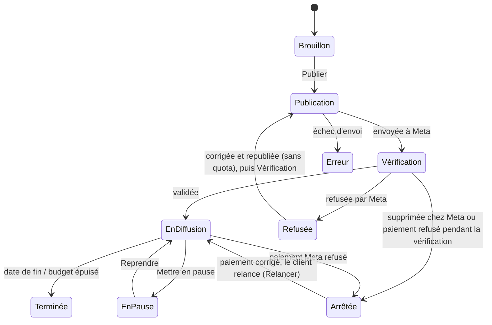
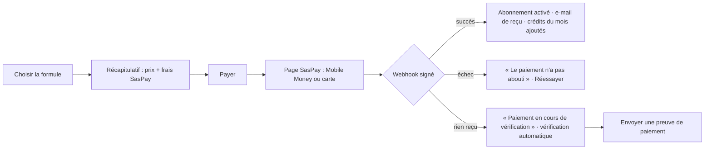

# AppFlow — Parcours et écrans Pubeka

> Version 1 · 10 octobre 2026 · Décrit **chaque écran, chaque parcours, chaque état** (chargement, vide, erreur, limites) du site public, de l'application et de l'administration.
> Documents liés : [PRD](PRD.md) · [TRD](TRD.md) · [Plans et crédits](plans-et-credits.md) · [Architecture](../architecture/ARCHITECTURE.md) · [Design system](../design/DESIGN-SYSTEM.md) · [Prototype choix du modèle](../design/prototype-choix-modele.html).
> Conventions : `→` = action de l'utilisateur ; **[Bouton]** = libellé exact ; ⟶ = transition automatique ; ⚠ = cas limite. Le ton de l'interface **tutoie** l'utilisateur ; les pubs générées vouvoient par défaut (`ad_address`).

---

## 0. Sommaire
1. Carte des écrans et adresses
2. Navigation globale (ordinateur, téléphone), loader, langue
3. Visiteur : site public
4. Inscription, connexion, mot de passe
5. Première configuration (onboarding)
6. Connexion Meta et bilan de santé
7. Tableau de bord
8. Créer une campagne (parcours principal)
9. Choix du modèle et génération de visuels
10. Atelier visuels
11. Aperçu, publication et vie de la campagne
12. Refus de la plateforme (Modérateur)
13. Statistiques et Optimiseur
14. Réglages
15. Abonnement, paiement, crédits
16. Notifications
17. Aide et support
18. Parrainage
19. Fin d'abonnement, lecture seule, suppression du compte
20. Administration
21. États transverses (chargement, vide, erreurs)
22. Différences téléphone / ordinateur

---

## 1. Carte des écrans et adresses

### Site public — `pubeka.com/{fr|en}`
| Écran | Adresse |
|---|---|
| Accueil | `/fr` |
| Fonctionnement | `/fr/fonctionnement` |
| Tarifs | `/fr/tarifs` |
| Page pays | `/fr/pays/cameroun`, `/fr/pays/cote-divoire`, … |
| Guides d'aide (publics) | `/fr/aide`, `/fr/aide/{guide}` |
| Blog | `/fr/blog`, `/fr/blog/{article}` |
| Légal | `/fr/confidentialite`, `/fr/conditions`, `/fr/suppression-des-donnees` |

### Application — `app.pubeka.com`
| Écran | Adresse |
|---|---|
| Connexion / inscription | `/connexion`, `/inscription`, `/mot-de-passe-oublie` |
| Première configuration | `/bienvenue/{etape}` |
| Tableau de bord | `/` |
| Campagnes | `/campagnes`, `/campagnes/nouvelle`, `/campagnes/{id}` |
| Visuels (atelier) | `/visuels`, `/visuels/nouveau`, `/visuels/{id}` |
| Statistiques | `/statistiques` |
| Réglages | `/reglages/{profil|kit-de-marque|pages|comptes-meta|notifications|equipe|abonnement|mes-donnees}` |
| Crédits et paiement | `/abonnement`, `/abonnement/payer`, `/credits/acheter`, `/abonnement/preuve` |
| Support | `/support`, `/support/{ticket}` |
| Parrainage | `/parrainage` |
| Administration | `/{chemin-secret}/…` (404 pour tout non-administrateur) |

---

## 2. Navigation globale

### 2.1 Ordinateur (≥ 980 px)
```
┌──────────────┬─────────────────────────────────────────────────────┐
│ [Page active ▾] │ Fil d'Ariane                🔍 Rechercher   🔔  ◯ │
│              │                                                     │
│ MENU         │  Bandeau : Campagnes actives · Dépensé ce mois ·    │
│ ▣ Accueil    │            Crédits restants  (3 infos max)          │
│ ▢ Campagnes  │                                                     │
│ ▢ Visuels    │  Contenu de l'écran                                 │
│ ▢ Statistiques│                                                    │
│ COMPTE       │                                                     │
│ ▢ Abonnement │                                                     │
│ ▢ Réglages   │                                                     │
│ ▢ Aide       │                                                     │
│ [Passer à Pro]│                                         (💬 Aide)  │
│ [Awa N.  ⇥]  │                                                     │
└──────────────┴─────────────────────────────────────────────────────┘
```
- **Sélecteur de Page** en haut de la barre latérale : liste des Pages Facebook connectées ; celles hors formule sont grisées avec le libellé « Hors de ta formule ».
- **Bandeau du haut** (PRD §10.1) : affiché **seulement si le compte a de l'activité** ; sinon remplacé par un appel à l'action.
- **Carte « Passer à Pro »** : visible pour Starter uniquement.
- **Carte utilisateur** en bas : nom, formule, menu (Réglages, Langue, Thème, **[Se déconnecter]**).
- **Bulle d'aide** (💬) en bas à droite sur tous les écrans de l'application.

### 2.2 Téléphone (< 980 px)
- Barre du haut : logo, 🔔, avatar.
- **Barre d'onglets en bas** : Accueil · Campagnes · Visuels · Compte.
- Bouton d'action principal **pleine largeur** en haut de l'écran d'accueil : **[Nouvelle campagne]**.
- Le sélecteur de Page passe dans l'onglet Compte et en tête de l'écran Campagnes.

### 2.3 Loader
- **Ouverture de l'application** (première page d'une session) : animation d'ouverture (3 s : le « p » du logo se dessine, puis le soulignement file sous « pubeka »), puis fondu.
- **Changement de page** : rien si la page arrive en moins de 300 ms ; sinon version courte en boucle (les deux blocs qui se dessinent) jusqu'à l'affichage.
- « Réduire les animations » activé : logo fixe, pas d'animation.

### 2.4 Langue et thème
- Langue de l'interface : menu utilisateur → **Français / English**. Le site public conserve l'adresse `/fr` ou `/en`.
- Thème : **Clair** (défaut) / **Sombre** / **Système**.

---

## 3. Visiteur : site public

### 3.1 Accueil `/fr`
1. Barre : logo · Fonctionnement · Tarifs · Aide · **[Se connecter]**.
2. Pastille « Nouveau » + annonce.
3. Titre : **« Tes pubs en ligne, prêtes en quelques clics. »**
4. Texte : « Colle le lien de ton site. Pubeka écrit la campagne, crée le visuel et la publie sur la plateforme de ton choix. Tu valides, c'est tout. »
5. **Champ héros** : `https://ta-boutique.com` + **[Créer ma pub]**.
6. Pastilles plateformes : Meta Ads (Disponible) · Google Ads (Bientôt) · TikTok Ads (Bientôt) · Et d'autres (À venir).
7. Liens « Pas de site ? **Envoie une photo** ou **décris ton business** ».
8. Capture de l'application, grille de fonctionnalités, liste « Le problème », tarifs, pied de page.

**Parcours du champ héros**
```
Colle un lien → [Créer ma pub]
   ⟶ lien gardé en mémoire de la session
   ⟶ /inscription (le lien est rappelé : « On analysera ta-boutique.com après ton inscription »)
   ⟶ après la première configuration : la création de campagne démarre avec ce lien déjà rempli
```
⚠ Lien invalide → message sous le champ : « Ce lien ne semble pas valide. Exemple : https://ta-boutique.com ».

### 3.2 Tarifs `/fr/tarifs`
- 3 cartes : Starter 5 000 XAF · **Pro 12 000 XAF (Recommandé, carte sombre)** · Business 25 000 XAF ; crédits, campagnes, Pages, membres, fonctions.
- Encadré « Crédits supplémentaires : 1 000 XAF le crédit ».
- Explication en 3 lignes : « 1 crédit = 1 image standard · une vidéo à partir de 2 crédits · le budget des pubs est payé directement à la plateforme ».
- FAQ : paiement Mobile Money, pas de prélèvement automatique, pas de remboursement, essai gratuit.
- **[Commencer l'essai gratuit]** → `/inscription`.

### 3.3 Pages pays, aide, blog
- Page pays : prix en monnaie locale, moyens de paiement du pays, TVA de la plateforme expliquée, **[Commencer l'essai gratuit]**.
- Guides publics : liste par catégorie (Payer ses pubs, Lier WhatsApp, Créer un pixel…), chaque guide finit par **[Essayer Pubeka]**.

---

## 4. Inscription, connexion, mot de passe

### 4.1 Inscription `/inscription`
```
[Continuer avec Google]   [Continuer avec Apple]
───────────── ou ─────────────
E-mail · Mot de passe (8 caractères min.) · [Créer mon compte]
☐ J'accepte les conditions d'utilisation et la politique de confidentialité (obligatoire)
```
- E-mail : envoi d'un **lien de confirmation** → écran « Vérifie ta boîte mail » (bouton **[Renvoyer le lien]** actif après 60 s).
- Google / Apple : compte créé directement.
- ⟶ `/bienvenue/pays`.

⚠ Cas limites :
| Situation | Message |
|---|---|
| E-mail déjà utilisé | « Un compte existe déjà avec cet e-mail. **Se connecter** » |
| Mot de passe trop court | « 8 caractères minimum. » |
| Lien de confirmation expiré | « Ce lien a expiré. **[Recevoir un nouveau lien]** » |
| Conditions non cochées | Bouton désactivé + « Accepte les conditions pour continuer. » |

### 4.2 Connexion `/connexion`
Google · Apple · e-mail + mot de passe · **[Mot de passe oublié ?]**.
⚠ 5 échecs d'affilée → connexion bloquée **15 minutes**, puis à nouveau possible + « Trop d'essais. Réessaie dans 15 minutes ou réinitialise ton mot de passe. »

### 4.2 bis Déconnexion pour inactivité
- **Après 10 minutes sans activité**, la session est fermée et l'utilisateur est renvoyé vers `/connexion`.
- **1 minute avant**, une fenêtre s'affiche : « Tu vas être déconnecté dans 60 s pour ta sécurité. **[Rester connecté]** ».
- Activité = clic, saisie, défilement, navigation. Une **génération ou une publication en cours n'est pas interrompue** : elle continue côté serveur et l'utilisateur est prévenu (notification + e-mail).
- Saisie en cours (brouillon de campagne) : enregistrée automatiquement avant la déconnexion, retrouvée à la reconnexion.
- Après reconnexion : retour à l'écran d'origine.

### 4.3 Mot de passe oublié
E-mail → lien de réinitialisation (valable 1 h) → nouveau mot de passe → connexion automatique.

---

## 5. Première configuration (onboarding)

Barre de progression « Étape X sur 5 ». Chaque étape a **[Continuer]** ; les étapes 4 et 5 ont aussi **[Plus tard]**.

| Étape | Écran | Contenu | Ce qui est enregistré |
|---|---|---|---|
| 1 | `/bienvenue/pays` | Pays (liste), ville, devise d'affichage (XAF/XOF, pré-remplie selon le pays) | `country_code`, `city`, `timezone`, `currency_display` |
| 2 | `/bienvenue/langue` | Langue de l'interface (FR/EN) | `ui_language` |
| 3 | `/bienvenue/essai` | « Ton essai gratuit commence : **1 campagne, 3 visuels, 7 jours**. Aucune carte demandée. » **[Commencer]** | abonnement `trialing`, crédits `trial` |
| 4 | `/bienvenue/meta` | Connexion Meta (voir §6) | connexion, Pages, comptes |
| 5 | `/bienvenue/marque` | Kit de marque : logo, couleurs, numéro WhatsApp, ton des pubs (vous/tu) | `brand_kits`, `pages.ad_address` |

⟶ Fin : si un lien a été saisi sur l'accueil → `/campagnes/nouvelle?source=lien` ; sinon → tableau de bord avec carte « Crée ta première pub ».

⚠ Essai déjà utilisé sur ce compte → l'étape 3 affiche « Ton essai a déjà été utilisé » + **[Choisir une formule]**.

---

## 6. Connexion Meta et bilan de santé

### 6.1 Connecter
```
Écran : « Connecte ton compte Meta »
Texte : ce que Pubeka pourra faire (créer et suivre tes campagnes) et ne fera jamais
        (publier sans ton accord, voir tes messages).
[Connecter mon compte Meta]  → fenêtre Facebook (Login for Business)
   → l'utilisateur choisit le portefeuille business, les Pages, les comptes publicitaires
   ⟶ retour Pubeka ⟶ bilan de santé
```
⚠ Fenêtre fermée ou permissions refusées → « La connexion n'a pas abouti. Sans accès à ton compte publicitaire, Pubeka ne peut pas publier. **[Réessayer]** ».

### 6.2 Choisir la Page active
- Liste des Pages ; la formule limite le nombre activable (1 / 3 / 10).
- Starter : une seule Page cochable ; texte « Tu pourras changer de Page le mois prochain si tu as lancé une campagne avec celle-ci. »
- Compte publicitaire : liste déroulante, changeable à tout moment (hors formule).

### 6.3 Bilan de santé (F1)
Liste verte / rouge, chaque ligne rouge a **[Comment faire]** qui ouvre le guide pas à pas (panneau latéral, ou plein écran sur téléphone) :

| Élément | Si rouge |
|---|---|
| Portefeuille business | Guide « Créer un portefeuille business » |
| Compte publicitaire | Guide « Créer un compte publicitaire » |
| Moyen de paiement Meta | Guide « Ajouter une carte ou des fonds prépayés » + lien **Keecash** pour une carte virtuelle |
| Page Facebook | Guide « Créer une Page » |
| Instagram lié | Facultatif · **[Ignorer]** possible |
| WhatsApp Business lié | **Fortement recommandé** (bandeau orange) |
| Pixel | Facultatif · guide par plateforme de site (Shopify, WordPress, Wix, sur mesure) |

**[Revérifier]** relance le bilan. **[Continuer quand même]** reste possible sauf si le compte publicitaire manque.

### 6.4 Expiration du jeton
- J-7 : bandeau + notification + e-mail « Ta connexion Meta expire le JJ/MM. **[Renouveler en 1 clic]** ».
- Expiré : bandeau rouge sur tous les écrans, synchronisation des statistiques suspendue, publication bloquée jusqu'à reconnexion.

---

## 7. Tableau de bord `/`

### 7.1 Contenu (compte actif)
1. **« Bonjour Awa »** ou **« Bonsoir Awa »** (heure locale) + phrase d'état (« 2 campagnes en diffusion, 1 en vérification chez Meta »).
2. **[Nouvelle campagne]** (bouton principal).
3. Bandeau 3 chiffres : Campagnes actives · Dépensé ce mois (FCFA, $ dessous) · Crédits restants.
4. Graphique des résultats (barres hachurées, mois sélectionné en Lime) — sélecteur Semaine / Mois.
5. Carte **Optimiseur** (Pro, Business) : une suggestion à la fois, **[Appliquer]** / **[Ignorer]**.
6. Tableau des campagnes (nom, état, résultats, dépensé, coût par résultat) → clic = détail.

### 7.2 États
| État | Affichage |
|---|---|
| Aucune campagne | Illustration sobre + « Aucune campagne pour l'instant. Colle le lien de ton site pour créer ta première pub. » + champ lien + **[Créer ma pub]** |
| Meta non connecté | Carte « Connecte ton compte Meta pour publier » **[Connecter]** |
| Essai en cours | Bandeau « Essai : X jours restants · 1 campagne · 3 visuels » **[Choisir une formule]** |
| Grâce (paiement en retard) | Bandeau orange « Ton abonnement a expiré le JJ/MM. Il te reste X jours pour renouveler. **[Payer]** » |
| Lecture seule | Bandeau rouge (voir §19) |
| Maintenance | Page dédiée avec le message de l'administrateur |

---

## 8. Créer une campagne `/campagnes/nouvelle`

Assistant en **une colonne** (max 640 px), avec aperçu à droite sur grand écran. Étapes indiquées en haut : **Sources → Questions → Proposition → Visuel → Aperçu → Publier**. **[Retour]** à chaque étape ; brouillon enregistré automatiquement.

### 8.0 Vérifications à l'entrée
| Condition | Écran affiché à la place |
|---|---|
| Meta non connecté | « Connecte ton compte Meta pour publier. » **[Connecter]** (on peut quand même préparer la campagne : **[Préparer sans publier]**) |
| Quota de campagnes atteint | « Tu as publié tes X campagnes de ce mois. » **[Passer à Pro]** · **[Préparer quand même]** (publication bloquée) |
| Lecture seule | Écran bloqué (voir §19) |

### 8.1 Étape « Sources »
```
Plateforme : (●) Meta Ads   ( ) Google Ads — Bientôt   ( ) TikTok Ads — Bientôt
Page : [Ma Boutique Akwa ▾]

Qu'as-tu sous la main ?
[🔗 Lien de site]  [📷 Photo du produit]  [📝 Publication]  [📄 Document PDF/Word]  [✍ Description]
(plusieurs choix possibles)

Ce que tu veux comme pub (facultatif) : [                         ]
[Analyser]
```
- Lien : champ URL. Photo : jusqu'à 10 images (10 Mo chacune). Document : PDF/Word 20 Mo. Publication : lien Facebook/Instagram/X ou capture.
- **[Analyser]** ⟶ écran d'attente « Je lis ton site… » (étapes cochées : lecture → compréhension → questions) ⟶ Analyste.

⚠ Cas limites :
| Situation | Comportement |
|---|---|
| Site illisible (protégé, vide) | Lecture interne → Jina en secours → si échec : « Je n'arrive pas à lire ce site. Ajoute une description ou une photo. » |
| Fichier trop lourd / mauvais format | « Ce fichier dépasse 10 Mo » / « Formats acceptés : JPG, PNG, WEBP, PDF, DOCX » |
| **Produit illégal évident** (drogue, armes, contrefaçon, médicaments sans ordonnance, arnaque) | Arrêt : « Pubeka ne peut pas créer de publicité pour ce produit : il est interdit par la loi et par les plateformes. » Aucun crédit, aucun quota consommé |
| Instruction cachée dans le site (injection) | Ignorée silencieusement, enregistrée pour l'administration |

### 8.2 Étape « Questions »
- 3 à 5 questions de l'Analyste, une par carte, champ adapté (téléphone, choix, lieu, nombre, texte).
- Chaque question affiche son « Pourquoi ? » en petit.
- Réponses pré-remplies si connues (kit de marque).
- **[Générer la proposition]**.

### 8.3 Étape « Proposition »
Affichage **progressif** (les champs se remplissent pendant l'écriture du Stratège). Bloc empilé :
```
┌───────────────── Proposition 1 · par l'IA ─────────── [Modifier] ┐
│ Objectif : Messages WhatsApp       (pourquoi : …)                │
│ Zone : Douala · 10 km              Budget : 3 000 FCFA/jour       │
│ Dates : 11 → 17 oct.               Ciblage : automatique (Advantage+) │
│ Texte : « … »  Titre : « … »  Bouton : Écrivez-nous sur WhatsApp  │
│ Coût : 21 000 FCFA · ≈ 35,00 $                                    │
└──────────────────────────────────────────────────────────────────┘
[Autre proposition]   [Continuer]
```
- **Coût** : budget par jour × nombre de jours (début et fin compris), **sans TVA** (TVA retirée pour le moment (décision du 17/10/2026), à réactiver sur décision). L'exemple ci-dessus suppose 7 jours à 3 000 FCFA par jour, soit 5 $ par jour, avec 1 $ = 600 FCFA : ce sont des **valeurs d'essai pour l'exemple**, jamais des valeurs du produit (le taux de change réel de chaque monnaie vient du marché, voir ARCHITECTURE §9.3). Calcul exact en entiers : 5 $ × 7 = 35,00 $ = 21 000 FCFA. Taux de change indisponible ou trop ancien : l'écran n'affiche que le dollar.
- **Estimation de la portée** : à venir avec la publication (S16), fournie par Meta (estimation de diffusion). L'écran n'affiche aucun chiffre inventé avant.
- **Ciblage** : automatique (Advantage+) d'abord. Le formulaire [Modifier] n'a pas de champ de centres d'intérêt ; les intérêts proposés par l'IA viendront plus tard (voir ROADMAP, « À planifier »).
- **[Modifier]** ouvre chaque champ en édition : objectif (avec description courte de chaque objectif), zone (carte + rayon), budget (min 1 $ ≈ 600 FCFA, conversion en direct), dates, textes (compteur de caractères, limite 125), bouton, langue de la pub.
- **[Autre proposition]** : nouvelle proposition avec un angle différent ; les précédentes restent accessibles (onglets « Proposition 1, 2, 3 »).
- Pixel : si objectif Ventes ou Trafic et pixel disponible → liste déroulante ; sans pixel : « Sans pixel, on ne verra pas ce qui se passe sur ton site. **[Installer un pixel]** · **[Continuer sans]** ».
- WhatsApp non lié et objectif Messages → bascule automatique sur Messenger + avertissement.

### 8.4 Étape « Visuel »
Trois choix :
1. **[Créer avec l'IA]** → §9 (choix du modèle, génération).
2. **[Utiliser un visuel de mon atelier]** → galerie des visuels existants (non expirés).
3. **[Importer mon visuel ou ma vidéo]** → envoi de fichier (vérification du format).

Option **[Tester 2 visuels (test A/B)]** : sélection de 2 visuels ; compte pour une seule campagne.

### 8.5 Étape « Aperçu »
- Onglets : Fil Facebook · Fil Instagram · Stories · Reels · Messenger.
- Formats manquants : « Ce visuel n'existe qu'en 4:5. **[Créer le format 9:16]** (inclus, sans crédit) » → extension par IA si nécessaire.
- Récapitulatif final (objectif, zone, budget, dates, coût total, sans TVA).

### 8.6 Étape « Publier »
- **Première publication de l'espace de travail** : fenêtre de responsabilité, à accepter **une seule fois par espace de travail** (la date et l'utilisateur sont enregistrés) — « La plateforme vérifie chaque pub. Pubeka n'est pas responsable si ton compte publicitaire est restreint à cause du contenu publié. **[J'ai compris]** ».
- **[Publier la campagne]** ⟶ « Publication en cours… » ⟶ quota de campagnes décompté ⟶ écran de succès :
  « Ta campagne est envoyée à Meta. Meta la vérifie, en général sous 24 heures. On te prévient dès qu'elle est en diffusion. » **[Voir ma campagne]** · **[Créer une autre pub]**.

⚠ Erreurs de publication :
| Situation | Message et action |
|---|---|
| Aucun moyen de paiement sur le compte publicitaire | « Ton compte publicitaire n'a pas de moyen de paiement. » **[Voir le guide]** · la campagne reste en brouillon, quota non décompté |
| Jeton Meta expiré | « Reconnecte ton compte Meta. » **[Reconnecter]** |
| Erreur Meta (code connu) | Traduction simple de l'erreur + action proposée ; quota non décompté |
| Erreur inconnue | « La publication a échoué. Réessaie dans quelques minutes. » + ticket proposé |

---

## 9. Choix du modèle et génération de visuels

Prototype : [prototype-choix-modele.html](../design/prototype-choix-modele.html).

### 9.1 Écran « Créer un visuel »
1. **Que veux-tu créer ?** Mon produit en situation · Un visuel sans photo · Modifier un visuel · Une vidéo (Bientôt, V2).
2. **Choisis un modèle** : 3 modèles (+ **[Voir tous les modèles]**) issus du catalogue ; chaque carte : nom, fournisseur, « Pour… », points forts (+), limite (–), coût en crédits pour la génération, durée estimée ; un modèle **« Recommandé pour ton cas »** présélectionné.
3. **Qualité** : Standard · Haute qualité (le coût se met à jour).
4. **Ta photo et tes références** : photo produit (obligatoire pour « produit en situation »), références (max selon le modèle, affiché) ; masqué pour « sans photo ».
5. Questions visuelles du Designer (3 à 5) : style, éléments à afficher (prix, numéro, logo), ambiance, couleurs, présence humaine.
6. Récapitulatif (bloc empilé) : modèle, qualité, nombre de visuels (3, format 4:5), durée, **coût en crédits**, crédits restants après. **[Générer 3 visuels]**.

### 9.2 Pendant la génération
```
Visuel 1  ████████░░  prêt dans ~10 s
Visuel 2  ██░░░░░░░░  en file · position 4 · ~40 s
Visuel 3  ░░░░░░░░░░  en file
« Tu peux quitter cette page : on te prévient quand c'est prêt. »
```
- Chaque visuel apparaît **dès qu'il est prêt**.
- Quitter la page ⟶ notification + e-mail à la fin.
- **Attente > 60 s** ⟶ bandeau : « Ce modèle est très demandé. Attente estimée : ~2 min. » **[Utiliser {modèle équivalent} (X crédits)]** · **[Attendre]**.

### 9.3 Résultat
- 3 visuels en grille 4:5 ; sélection = bordure Lime ; actions par visuel : **[Choisir]** · **[Modifier]** · **[Télécharger]** · **[Utiliser dans une campagne]**.
- **[3 autres]** : nouvelle génération (nouveau coût), en s'inspirant des visuels choisis.
- Mention : « Les fichiers non utilisés sont supprimés après 7 jours (le JJ/MM). »

### 9.4 Modifier un visuel
- Barre de saisie : « Que veux-tu changer ? » (ex. « change le numéro », « fond plus clair »).
- **Changement de texte, numéro, prix, logo** ⟶ instantané, **0 crédit**, sans IA.
- **Changement de scène** (fond, lumière) ⟶ modèle de modification choisi, coût en crédits affiché avant.
- Avant / après côte à côte ; **[Garder]** · **[Annuler]**.

### 9.5 Crédits
| Situation | Comportement |
|---|---|
| Crédits suffisants | Crédits **réservés** au lancement, **consommés** au succès |
| Échec, contenu refusé par le fournisseur, annulation | Crédits **rendus** + message « Ce visuel n'a pas pu être créé. Tes crédits t'ont été rendus. » |
| Crédits insuffisants | Bouton remplacé par « Il te manque X crédits. » **[Acheter des crédits]** · **[Choisir un modèle moins cher]** |
| Plafond quotidien atteint | « Tu as atteint la limite de générations du jour. Reviens demain. » |
| Essai | Limité à 3 visuels au total |

---

## 10. Atelier visuels `/visuels`

- Grille de tous les visuels (filtres : Choisis · Utilisés en campagne · Expirent bientôt · Vidéos).
- Chaque vignette : date, modèle, format, état d'expiration (« Supprimé dans 2 jours »).
- **[Nouveau visuel]** → §9 (sans campagne).
- Détail d'un visuel : formats disponibles, **[Créer un autre format]**, **[Modifier]**, **[Télécharger]**, **[Créer une campagne avec ce visuel]** (ouvre §8 avec le visuel déjà choisi), **[Proposer des visuels similaires]**.
- Références : **[Ajouter une référence]** (épingler dans le kit de marque = conservée au-delà de 7 jours).
- État vide : « Aucun visuel. Crée ton premier visuel à partir d'une photo de ton produit. » **[Créer un visuel]**.

---

## 11. Vie de la campagne `/campagnes/{id}`

### 11.1 En-tête
Nom, plateforme, Page, **pastille d'état**, actions : **[Mettre en pause]** / **[Reprendre]** · **[Modifier]** · **[Dupliquer]** · **[Relancer]** (F9).

### 11.2 États et transitions

*Une campagne « Refusée » repart vers « Publication » (puis « Vérification »). Une campagne « Arrêtée » repart vers « En diffusion » quand le client, après avoir réglé sa facture ou alimenté ses fonds publicitaires chez Meta, revient sur Pubeka et la relance lui-même (événement `recover`, route `relaunch` de S16).*
| Pastille | Texte affiché |
|---|---|
| Brouillon | « Pas encore publiée » |
| Vérification | « Meta vérifie ta pub, en général sous 24 heures. » |
| En diffusion | « Ta pub est visible. » |
| En pause | « Mise en pause par toi le JJ/MM. » |
| Refusée | « Meta a refusé ta pub. **[Voir pourquoi]** » |
| Arrêtée | « Le paiement Meta a échoué. Paie ta facture ou alimente tes fonds sur Meta, puis reviens ici. **[Voir le guide]** · **[Relancer]** » |
| Terminée | « Terminée le JJ/MM. **[Relancer]** » |

### 11.3 Onglets
- **Résultats** : résultat principal traduit en argent (« 42 messages WhatsApp, soit 357 FCFA par client potentiel »), graphique, statistiques détaillées repliées (portée, impressions, clics, CTR, CPM, fréquence), statistiques du pixel ; mis à jour toutes les heures, **[Actualiser]** ; l'écran se rafraîchit seul.
- **Pubs** : chaque pub et son visuel ; test A/B : gagnante indiquée.
- **Réglages** : budget, dates, zone, textes (modification envoyée à Meta, peut relancer une vérification : prévenu avant).
- **Historique** : événements (publication, vérification, pauses, refus, modifications).

### 11.4 Relancer (F9)
**[Relancer]** → choix : « Même visuel » · « 2 nouveaux visuels similaires » · « Changer de visuel » → retour à l'étape Aperçu avec la proposition copiée → **[Publier]** (compte comme une nouvelle campagne).

### 11.5 Page hors formule
Bandeau gris « Cette Page n'est plus dans ta formule : la campagne continue chez Meta mais ne peut plus être modifiée ici. **[Changer de formule]** ».

---

## 12. Refus de la plateforme (Modérateur)

```
Webhook Meta « refusée » ⟶ Modérateur ⟶ rapport
⟶ notification + e-mail « Ta pub a été refusée. On t'explique pourquoi. »
```
Écran **[Voir pourquoi]** :
1. **Ce qui s'est passé** (3 à 5 phrases simples).
2. **L'élément en cause** surligné (texte, visuel ou page de destination).
3. **La correction proposée** (texte complet prêt, ou consigne pour le visuel).
4. Boutons : **[Appliquer la correction et republier]** (sans consommer de quota) · **[Modifier moi-même]** · **[Demander un nouvel examen]** (si le Modérateur pense que Meta s'est trompé : guide de la démarche).
5. Produit interdit par la plateforme (`can_fix = false`) : explication respectueuse, aucun bouton de republication.

---

## 13. Statistiques et Optimiseur `/statistiques`

- Sélecteur de période et de Page ; cartes chiffres (dépensé, résultats, coût par résultat, portée) ; graphique ; tableau par campagne.
- **Premium (Pro, Business)** : comparaison avec tes campagnes précédentes ; **[Exporter en PDF]** ; analyse des concurrents (bibliothèque publicitaire, selon disponibilité).
- Starter : ces blocs sont visibles mais verrouillés avec **[Passer à Pro]**.
- **Optimiseur** : liste des suggestions (« Ta pub 2 coûte 3 fois plus cher par message que la 1. La mettre en pause ? ») avec preuve chiffrée ; **[Appliquer]** (action envoyée à Meta, confirmée) · **[Ignorer]**. Données insuffisantes : « Attends encore 2 jours pour une recommandation fiable. »

---

## 14. Réglages `/reglages/…`

| Section | Contenu | Remarques |
|---|---|---|
| Profil | Nom, e-mail, téléphone, pays, ville, devise, langue, thème | Changer de pays recalcule fuseau et monnaie |
| Kit de marque (par Page) | Logo, couleurs, police, numéro WhatsApp, slogan, **ton des pubs (vous / tu)**, langue des pubs, afficher le numéro sur les visuels | Lignes de réglage avec interrupteurs |
| Pages | Pages connectées, activation selon la formule, Page figée pour la période | Message de limite |
| Comptes Meta | Connexion, type (utilisateur système / classique), date d'expiration, comptes publicitaires, **[Revérifier]**, **[Déconnecter]** | Bilan de santé |
| Notifications | Par type : cloche / e-mail | |
| Équipe | Membres, rôles (Propriétaire, Éditeur, Lecteur), **[Inviter]** (e-mail), limite selon la formule | Pro 2, Business 5 |
| Abonnement | Voir §15 | |
| Mes données | **[Télécharger mes données]**, **[Supprimer mon compte]** (§19.3) | |

---

## 15. Abonnement, paiement, crédits

### 15.1 Écran Abonnement `/abonnement`
- Formule actuelle, période (du JJ/MM au JJ/MM), crédits du mois restants, crédits achetés, historique des paiements (reçus téléchargeables).
- **[Changer de formule]** · **[Payer le mois suivant]** · **[Acheter des crédits]**.

### 15.2 Payer une formule

- Récapitulatif : « Starter — 5 000 XAF + frais SasPay X XAF = total ». « Aucun remboursement. Pas de prélèvement automatique : tu renouvelles chaque mois. »
- Retour de SasPay : écran « Paiement en cours de vérification… » jusqu'au webhook (rafraîchi seul).

### 15.3 Acheter des crédits `/credits/acheter`
- Choix de la quantité (1, 5, 10, 20, saisie libre) × **1 000 XAF** ; rappel : « 1 crédit = 1 image standard · vidéo à partir de 2 crédits · ces crédits n'expirent jamais ».
- Même parcours de paiement.

### 15.4 Changer de formule
- **Monter** (ex. Starter → Pro) : le client **paie la différence de prix** (Pro 12 000 − Starter 5 000 = **7 000 XAF**) ; la **période reste la même** (même date de fin) ; il reçoit **la différence de crédits** du mois (15 − 10 = **+5 crédits**) et les nouvelles limites (Pages, campagnes, membres) immédiatement.
- **Descendre** : effective à la fin de la période ; avertissement sur les Pages en trop (campagnes non modifiables).

### 15.5 Preuve de paiement `/abonnement/preuve`
Formulaire : numéro de transaction, capture, montant, date → **[Envoyer]** ⟶ ticket « Paiement » créé ⟶ visible dans l'administration ⟶ activation manuelle ⟶ notification + e-mail.

### 15.6 Rappels
J-3, J-1, J0 : bandeau + notification + e-mail « Ton abonnement se termine le JJ/MM. **[Payer]** ».

---

## 16. Notifications

- 🔔 avec compteur ; panneau : liste chronologique, **[Tout marquer comme lu]**, clic = écran concerné.
- Types : génération prête · pub validée · pub refusée · paiement Meta échoué · budget épuisé · campagne terminée · quota presque atteint · abonnement qui se termine · jeton Meta à renouveler · réponse du support · résumé du lundi · suggestion de l'Optimiseur.
- Chaque type existe aussi par e-mail (selon les préférences).

---

## 17. Aide et support

### 17.1 Bulle d'aide (Assistant)
- 💬 en bas à droite → panneau de conversation.
- L'Assistant connaît l'état du compte : « Ta pub ne peut pas démarrer car ton compte publicitaire n'a pas de moyen de paiement. » + étapes + lien vers l'écran ou le guide.
- Hors sujet : réponse polie et retour au sujet Pubeka.
- Ne sait pas : **[Écrire au support]** → ticket pré-rempli avec la conversation.

### 17.2 Support `/support`
- Liste des tickets (Ouvert · En attente de ta réponse · Fermé).
- **[Nouveau ticket]** : sujet, catégorie (Paiement, Campagne, Compte, Autre), message, pièces jointes.
- Fil de messages ; réponse de l'équipe reçue **ici et par e-mail** ; l'utilisateur peut **répondre directement depuis l'e-mail** (sa réponse s'ajoute au ticket) ou dans l'application.

---

## 18. Parrainage `/parrainage`

- Lien et code personnels, **[Copier]**, **[Partager sur WhatsApp]**.
- Règle affichée : « Quand ton filleul paie sa première formule, **vous recevez chacun 2 crédits**. » (crédits bonus, n'expirent pas).
- Liste : inscrit · a payé · récompensé.

---

## 19. Fin d'abonnement, lecture seule, suppression

### 19.1 Délai de grâce (3 jours)
Tout fonctionne ; bandeau orange permanent avec compte à rebours et **[Payer]**.

### 19.2 Lecture seule
- Bandeau rouge : « Ton abonnement est terminé. Tes campagnes continuent chez Meta, mais tu ne peux plus créer, générer ni modifier. **[Renouveler]** ».
- Accessible : tableau de bord, statistiques, visuels (téléchargement), réglages, support, paiement.
- Bloqué (boutons désactivés avec infobulle « Renouvelle ton abonnement ») : nouvelle campagne, génération, modification, reprise.
- **Toujours autorisé : [Mettre en pause]** une campagne en cours. La pause est **envoyée directement à Meta Ads** (la pub s'arrête chez Meta, le client ne dépense plus).
- Les **crédits achetés restent** et redeviennent utilisables au renouvellement.

### 19.3 Supprimer son compte
```
Réglages > Mes données > [Supprimer mon compte]
⟶ écran d'explication : ce qui est supprimé (tout chez Pubeka), ce qui reste (campagnes chez Meta,
   factures conservées par obligation légale), crédits perdus
⟶ saisir « SUPPRIMER » + mot de passe (ou reconnexion Google/Apple)
⟶ e-mail de confirmation ⟶ suppression effective ⟶ déconnexion
```

---

## 20. Administration `app.pubeka.com/{chemin-secret}`

### 20.1 Accès
```
Non-administrateur ⟶ 404 (page « introuvable » standard)
Administrateur ⟶ connexion Pubeka ⟶ code à 6 chiffres (application d'authentification)
   5 échecs ⟶ blocage temporaire + e-mail d'alerte
Chaque action ⟶ journal (qui, quoi, quand, avant/après)
```

### 20.2 Écrans
| Écran | Actions |
|---|---|
| Vue d'ensemble | Abonnés par formule, revenus du mois, coûts IA, marge, générations, temps d'attente moyen par file, soldes fournisseurs, alertes |
| Utilisateurs | Recherche ; fiche : profil, formule, crédits (registre), Pages, campagnes, tickets ; **[Modifier]**, **[Suspendre]**, **[Voir comme le client]** (lecture seule, journalisé) |
| Abonnements et paiements | Paiements SasPay, preuves en attente → **[Activer]** / **[Refuser]** avec note ; prolonger ; changer de formule |
| Crédits | **[Offrir]** / **[Retirer]** avec motif obligatoire |
| Tickets | File des tickets, réponse (envoyée dans l'application et par e-mail), fermeture |
| Catalogue de modèles | Visibilité (en test / actif / désactivé), recommandé par usage, fiche FR/EN, niveaux Standard/Haute qualité (réglages, coût mesuré, crédits), durées vidéo |
| Routage et fournisseurs | Principal / secours par capacité, attente max (60 s), budget mensuel (15 $), soldes, limites simultanées |
| Coûts | Par utilisateur, par agent, par modèle, par fournisseur ; marge réelle |
| TVA et change | Taux par pays (source, date de vérification) ; taux de change, valeur forçable |
| Bibliothèque de références | Ajouter, classer (secteur, style, format), noter |
| Refus et mémoire | Refus récents, motifs mémorisés |
| Contenu public | Articles de blog générés (brouillon IA → relu → publié), guides d'aide |
| Paramètres | Prix du crédit, seuils de marge, quotas des formules, plafond quotidien, essai, **mode maintenance** (message, activer/désactiver) |
| Journal | Toutes les actions d'administration |

---

## 21. États transverses

| Situation | Comportement |
|---|---|
| Chargement d'une page | Loader (voir §2.3) ; contenu en squelettes gris pour les listes et graphiques |
| Liste vide | Une phrase qui dit quoi faire + un bouton d'action |
| Hors connexion | Bandeau « Pas de connexion internet. Tes modifications seront envoyées au retour du réseau. » ; ce qui est saisi (brouillons, réglages) est **gardé sur l'appareil** et envoyé automatiquement au retour du réseau ; les actions irréversibles (publier, payer, générer) sont désactivées hors connexion |
| Erreur serveur | « Une erreur est survenue. Réessaie. » + identifiant d'erreur (Sentry) + **[Écrire au support]** |
| Session expirée (10 min d'inactivité) | Avertissement 60 s avant, puis retour à la connexion et à l'écran d'origine (voir §4.2 bis) |
| Droits insuffisants (rôle Lecteur) | Boutons d'action absents ; message « Demande à un propriétaire de l'espace. » |
| Fonction réservée à une formule | Bloc visible mais verrouillé + **[Passer à Pro]** |
| Maintenance | Page dédiée avec le message de l'administrateur ; site public accessible |
| Fournisseur en panne | Modèles concernés marqués « Indisponible » ; bascule proposée |
| Notifications d'action | Petite bannière sombre en bas, 5 s : « Campagne mise en pause », « Visuel enregistré »… |

---

## 22. Différences téléphone / ordinateur

| Élément | Téléphone | Ordinateur |
|---|---|---|
| Navigation | Onglets en bas | Barre latérale |
| Création de campagne | Une étape par écran, aperçu en fin de parcours | Colonne + aperçu permanent à droite |
| Choix du modèle | Cartes empilées, coût sous la description | Cartes avec coût à droite, récapitulatif collant |
| Statistiques | Cartes empilées, graphique pleine largeur | Grille, graphique + tableau |
| Guides d'aide | Plein écran | Panneau latéral |
| Bouton principal | Pleine largeur | Taille normale, en haut à droite |
| Réglages | Sous-menu en rangée défilante | Double navigation (barre latérale + sous-menu) |

---

